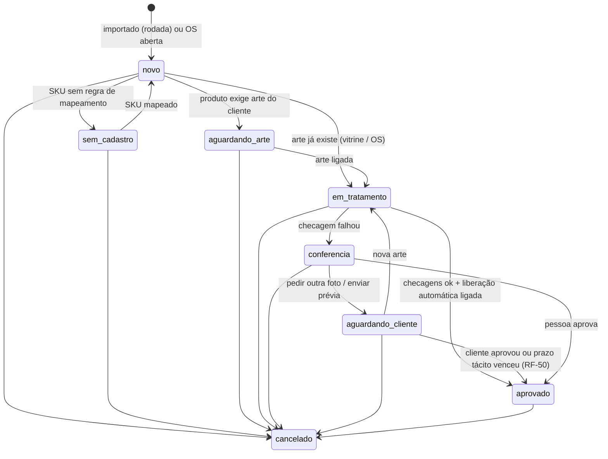
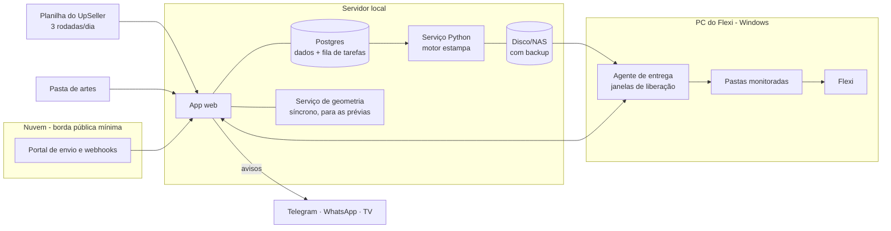

# PRD — Sistema de produção de personalizados

| | |
|---|---|
| **Versão** | 0.2 — revisada depois das críticas da dona, da engenharia e de completude (ver [REVISAO.md](REVISAO.md), seção "Decisões da revisão") |
| **Data** | 15/10/2026 |
| **Situação** | Aguardando validação. A **Parte A** é para a dona aprovar; a **Parte B** é o anexo técnico para o administrador técnico (o marido) e para quem for programar. |
| **Escopo agora** | Sublimação: almofada simples, almofada com fotomoldura, capa de travesseiro, capa de porta, fachada e vestuário (camisetas, uniformes, shorts). Canecas, calças, DTF, laser e impressão 3D ficam para depois. |
| **Documentos relacionados** | [REVISAO.md](REVISAO.md) (o que existe hoje e o que está errado) · [PLANEJAMENTO.md](PLANEJAMENTO.md) · [UNIFORMES.md](UNIFORMES.md) · [FLEXI.md](FLEXI.md) |

---

# PARTE A — Versão para a dona (leitura de 15 minutos)

> Esta parte usa só palavras da produção. Se alguma palavra não for a que você usa, ela está na lista do item A8. Para trocar, basta riscar e escrever a sua.

## A1. Em uma frase

**A foto do cliente entra numa pasta com o número do pedido no nome, a almofada sai pronta (47×47, borda preta e código), vai para a impressora certa na ordem dos pedidos, e você só olha o que tem problema.** No uniforme, você faz a arte uma vez por parte, como no SpeedCorel, e vê todos os tamanhos lado a lado antes de imprimir.

## A2. Como é hoje

O que você já nos contou:

- Mais de 1.000 almofadas por dia. Pedidos no UpSeller (Shopee, Mercado Livre, TikTok Shop). As fotos chegam pelo chat dos marketplaces e pelo WhatsApp.
- Cada almofada é montada à mão no Corel: quadrado 47×47 com borda preta, quadrado 45×45 com PowerClip, a arte dentro e o código do pedido na borda branca.
- A arte é criada no Lovart, fechada no Corel e exportada em PDF ou PNG. O Flexi espelha e encaixa no rolo. A prensa é o padrão e a calandra serve para o rolo a rolo e para o que não cabe na prensa.
- No uniforme, você usa os moldes SpeedCorel e a macro de nomes e números.

O que **ainda não sabemos** e vamos descobrir acompanhando **um dia de produção** (ou um dia gravado), em vez de mandar questionário:

| Etapa | O que vamos anotar |
|---|---|
| Baixar as fotos | Quem baixa, de onde (chat da Shopee, do ML ou do próprio UpSeller), como dá nome ao arquivo e quanto tempo leva |
| Montar no Corel | Quantas almofadas por página e quanto tempo por almofada |
| Imprimir | Metros de papel por dia, quantas trocas de rolo, se frente e verso saem juntos |
| Prensa | Quanto tempo leva uma prensada (com carga e descarga) e quantas peças entram em cada uma |
| Corte e costura | Quem corta e como; como juntam a frente com o verso; como sabem de qual pedido é a almofada depois de costurada |
| Expedição | Como casam a almofada com a etiqueta do UpSeller |
| Fotos | A nitidez real das fotos de 200 pedidos que vocês já imprimiram e o cliente aceitou |

Com isso escrevemos a seção "Como é hoje" com o tempo de cada etapa. **Só depois disso fixamos as metas.**

## A3. Como vai ser o seu dia

1. **Manhã — rodada 1 de pedidos.** A atendente exporta a planilha do UpSeller e solta o arquivo no sistema (um arquivo, uma vez). Combinamos 3 rodadas por dia, antes de cada lote, e não de 15 em 15 minutos.
2. **Fotos.** A atendente pede a foto no chat do próprio marketplace usando uma mensagem pronta que o sistema copia com um clique. Ninguém manda link para fora da Shopee ou do ML. A foto que chega é salva na **pasta de artes** com o número do pedido no nome, por exemplo `2410157ABCDEF_frente.jpg`. O sistema liga a foto ao pedido sozinho. Dá para soltar 100 fotos de uma vez.
3. **Você abre "Hoje".** Lá aparecem só as almofadas com problema: foto pequena, foto que corta muito ou rosto na borda. Cada uma mostra a almofada como vai ser impressa. Você resolve com uma tecla: imprimir assim, enquadrar ou pedir outra foto.
4. **Plano do dia.** O sistema mostra, por lote, quantas prensadas vão ser, quantos metros de papel vão em cada impressora e quando o rolo vai acabar.
5. **Impressão.** O Flexi recebe a frente e o verso de cada almofada juntos, na ordem dos pedidos, para a costura não precisar procurar par numa pilha.
6. **Prensa e costura.** Um clique marca o lote inteiro (e não peça por peça). Antes da costura, as almofadas são separadas por pedido, com uma ficha que continua legível depois de costurada. Como fazer isso de verdade vamos decidir depois de ver a sua produção (pergunta 4).
7. **Expedição.** Continua no UpSeller, como hoje.
8. **Uniforme.** Você escolhe o modelo, solta a arte de cada parte no Menu de edição, arrasta as logos para os marcadores 1 a 4 e vê o resultado em todos os tamanhos. A lista tem tamanho de camisa e de short, goleiro e uniforme 2. A prova vai pelo WhatsApp, e o "aprovado" do responsável é registrado com o print da conversa.
9. **Balcão.** A Nova OS sai em 1 minuto, e o aviso vai para o grupo de WhatsApp, o Telegram e a TV.

## A4. Como as telas vão ficar (esboços para você aprovar)

Os esboços abaixo mostram **o que vai em cada tela e onde**. Não mostram cores nem acabamento. Na primeira entrega (até 30/10) você recebe também:

- **As imagens de verdade:** a mesma arte nos tamanhos 2, BLM, M e XGG nas duas versões de encaixe, lado a lado com o seu arquivo do Corel.
- **Um "antes × depois":** a tela do protótipo rejeitado ao lado da tela nova.

Essas imagens usam os moldes licenciados da SpeedCorel, por isso ficam numa pasta privada e não neste documento. **Ninguém programa uma tela antes de você aprovar o esboço dela.**

**Tela 1 — Conferência da almofada simples** (só as que têm problema)

```
+--------------------------------------------------------------------------------+
| CONFERÊNCIA  [Almofada simples 37] [Fotomoldura 12] [Uniforme 2] [Outros 3]    |
| Mostrar:  (o) Foto pequena 18   ( ) Corta muito 11   ( ) Rosto na borda 8      |
+--------------------------------------------------------------------------------+
|  +-----------------+  +-----------------+   Pedido 2410157ABCDEF  (Shopee)     |
|  |#################|  |#################|   Item 1 de 2 - Almofada 45 F/V      |
|  |#  a almofada   #|  |#  verso        #|   Postar até: HOJE 16:00             |
|  |#  como vai     #|  |#  (igual à     #|                                      |
|  |#  imprimir     #|  |#   frente)     #|   ! Foto pequena: 64 DPI em 45 cm    |
|  +-----------------+  +-----------------+     Vai sair um pouco borrada.       |
|   FRENTE 47x47 com borda e código            [A] Imprimir assim                |
|                                              [E] Enquadrar  [N] Pedir outra    |
|  < anterior                   12 de 18                       próximo >         |
+--------------------------------------------------------------------------------+
```

**Tela 2 — Fotomoldura: foto dentro do coração** (arrastar e dar zoom, como no PowerClip)

```
+--------------------------------------------------------------+
| FOTOMOLDURA "I ♥ My Girlfriend" - Pedido 2410157ABCDEF       |
+--------------------------------------------------------------+
|        .-""-.  .-""-.                                         |
|       /      \/      \      Arraste a foto para mover         |
|      |    (rosto)     |     Roda do mouse = zoom              |
|       \     foto     /      Setas = ajuste fino               |
|        '.          .'                                         |
|          '.      .'         [Voltar ao automático]            |
|            '.  .'           [Trocar foto]      [Aprovar]      |
|              ''                                               |
|        I ♥ MY GIRLFRIEND                                      |
|  (a parte da foto fora do coração aparece clarinha)           |
+--------------------------------------------------------------+
```

**Tela 3 — Uniforme: Menu de edição** (igual à página do SpeedCorel)

```
+------------------------------------------------------------------------------+
| UNIFORME  Time Leões - Camiseta esportiva gola careca    Passo 2 de 7: Arte  |
+------------------------------------------------------------------------------+
|  FRENTE (57x75 cm)    COSTAS (57x78 cm)    MANGA ESQ.   MANGA DIR.   GOLA     |
|  +-------------+      +-------------+      +--------+   +--------+  +-----+  |
|  | [1]     [2] |      | PATROCÍNIO  |      |  [3]   |   |  [4]   |  |=====|  |
|  |     \ /     |      |     10      |      |  \ /   |   |  \ /   |  +-----+  |
|  |      X      |      |      X      |      |   X    |   |   X    |  Faixa:   |
|  |     / \     |      | PATROCÍNIO  |      |  / \   |   |  / \   |  amarela  |
|  +-------------+      +-------------+      +--------+   +--------+           |
|  Solte aqui a arte de cada parte (PNG ou PDF do Corel)                       |
|  Logos: arraste para 1 2 3 4  -  marcador vazio = sem cor                    |
+------------------------------------------------------------------------------+
```

**Tela 4 — Uniforme: resultado por tamanho** (você escolhe o encaixe vendo o resultado)

```
+------------------------------------------------------------------------------+
| RESULTADO POR TAMANHO - MANGA CURTA   Encaixe: (o) Igual ao SpeedCorel       |
|                                                ( ) Sem esticar (corta sobras)|
|                                                ( ) Tamanho real (listras)    |
|   2        10       BLP      BLM      BLXG      P        M        XGG        |
|  +--+    +---+    +---+    +---+    +----+    +---+    +----+   +-----+      |
|  |  |    |   |    |   |    |   |    |    |    |   |    |    |   |     |      |
|  +--+    +---+    +---+    +---+    +----+    +---+    +----+   +-----+      |
|  ok      ok       ok       ok      ! arte     ok       ok      ! foto        |
|                                     esticada                    pequena      |
+------------------------------------------------------------------------------+
```

**Tela 5 — Plano do dia** (também aparece na TV da produção)

```
+--------------------------- PLANO DO DIA - 15/10 -----------------------------+
| Rodada 2 (11:00)      Impressora 1          Impressora 2        Prensa        |
| 380 almofadas         412 peças             348 peças           127 prensadas |
| 760 peças             65 m de papel         55 m de papel       ~3 h 10 min   |
|                       ! o rolo acaba no     rolo ok             (estimativa;  |
|                         meio deste lote     (sobram 230 m)      vamos medir)  |
+------------------------------------------------------------------------------+
```

**Antes × depois** (o que vamos corrigir; os motivos são hipóteses nossas até você responder a pergunta 2)

| No protótipo rejeitado | Na versão nova |
|---|---|
| Molde desenhado à mão, igual para todos os modelos | Os moldes reais dos seus PDFs, um desenho por modelo |
| Listras e "FC" inventados | A sua arte, solta por parte |
| Tamanho 2 recebendo só um pedaço da arte | Cada tamanho recebe a arte inteira, encaixada |
| Desenho ilustrativo no lugar da almofada | A miniatura é o próprio arquivo que vai para o Flexi |
| Barras "mover para os lados" | Arrastar e rolar o mouse |
| Almofada simples e fotomoldura misturadas | Cada uma na sua aba |

## A5. O que muda a cada mês

As entregas são de 2 semanas e cada uma termina com uma demonstração para você. As datas consideram **uma pessoa programando**, os feriados nacionais e uma pausa de fim de ano de 24/12 a 03/01 (que precisa ser confirmada). São estimativas e serão revistas no fim da primeira entrega.

| Até | O que você consegue fazer |
|---|---|
| **30/10/2026** | Ver os seus moldes no sistema iguais ao Corel e escolher o encaixe olhando as duas versões. Aprovar os esboços das telas. O erro que apagava arte já estará corrigido. |
| **13/11/2026** | **Primeiro ganho:** soltar uma pasta de fotos com o número do pedido no nome e receber as almofadas simples prontas (47×47, borda, código) para o Flexi, conferindo pela miniatura. Isso roda **em paralelo ao Corel**, sem risco para a produção. |
| **27/11/2026** | Importar os pedidos do UpSeller em 3 rodadas por dia. Ver o plano do dia com prensadas e metros de papel. |
| **23/12/2026** | Conferir só as almofadas com problema. Piloto da impressão sem conferência. Almofada identificada depois da costura. |
| **22/01/2027** | Fotomoldura no sistema (foto no coração pelo rosto, ajuste por arrasto). No uniforme: Menu de edição e resultado por tamanho com os moldes reais. |
| **23/02/2027** | Primeiro time real impresso pelo sistema: lista com tamanho de camisa e short, goleiro, prova pelo WhatsApp. OS de balcão na tela. |
| **23/03/2027** | TV da produção por equipamento e marcação por lote. Decisão sobre receber fotos direto dos marketplaces e sobre mockups (Rapid Mockup ou construir). |

Bebê, XXXG e qualquer tamanho que falte não esperam a última fase. Desde janeiro, um tamanho sem molde pode ser **feito no Corel e anexado ao mesmo projeto**, e o time não fica parado. Assim que chegar o PDF do molde, ele é importado.

## A6. As 12 perguntas para você

Para cada uma, marque uma opção ou escreva a sua. As que dependem de imagem serão mostradas com imagem na conversa.

1. **Encaixe da arte no uniforme.** Vendo a mesma arte na manga curta BLXG nas duas versões, qual vira o padrão?
   ( ) Igual ao SpeedCorel (estica a manga até caber)  ( ) Sem esticar (corta as sobras)  ( ) Depende do modelo
2. **O que ficou feio.** Olhando as telas antigas, aponte o que incomodou: ( ) as telas  ( ) os moldes  ( ) os arquivos impressos  ( ) tudo
3. **Pasta de artes.** Hoje, quem baixa as fotos e onde salva? Dá para salvar com o número do pedido no nome (`2410157ABCDEF_frente.jpg`)? ( ) Sim  ( ) Sim, mas o nome é outro: ______
4. **Depois de costurada**, como vocês sabem de qual pedido é a almofada?
   ( ) Separamos por pedido antes de costurar  ( ) Vai com a etiqueta do UpSeller  ( ) Outro: ______
5. **Foto pequena.** Vocês imprimem foto de WhatsApp mesmo um pouco borrada? A partir de que ponto não imprimem? (Mostraremos 3 exemplos impressos.)
6. **Verso da almofada simples.** Em cada anúncio, o verso é: ( ) igual à frente  ( ) liso  ( ) outra foto  ( ) varia por anúncio
7. **Fotomolduras.** Quais estão à venda e quantas fotos tem cada uma? Alguma leva **nome ou data**? Com que frequência entram molduras novas (Dia dos Namorados, Dia das Mães)?
8. **Pedido com 2 almofadas ou kit**, cada uma com uma foto diferente: acontece muito? ( ) quase nunca  ( ) às vezes  ( ) muito
9. **Almofada sem nenhum problema** pode ir direto para a impressora sem ninguém olhar, depois de um piloto de uma semana? ( ) Sim  ( ) Não  ( ) Só a simples
10. **Tamanhos no time.** Como chega o tamanho de cada jogador? Acontece camisa de um tamanho e short de outro, goleiro com camisa diferente e uniforme 1 e 2?
11. **Conferência.** Quantas pessoas vão conferir as artes, e quem?
12. **Tamanhos que faltam.** De onde virão os moldes de bebê, XXXG e calça? Você preenche uma vez uma tabela "como eu escrevo o tamanho" (EG, EXG, XGG, G1…)?

Mais uma conversa de 15 minutos para conferir as palavras da lista A8.

## A7. O que pedimos a você e ao seu marido

| Quem | O quê | Quanto tempo |
|---|---|---|
| Você | Gravar a tela do **seu** Corel montando um time real (Menu de edição → resultado por tamanho) | ~10 min |
| Você | Deixar acompanhar (ou gravar) um dia de produção | 1 dia |
| Você | Responder as 12 perguntas acima, numa conversa | ~40 min |
| Você | Separar 3 a 5 artes de uniforme como saem do Corel e a lista das fotomolduras com os PNGs | — |
| Seu marido | Baixar as legendas dos vídeos principais do canal @SpeedcorelBR, começando pelo tutorial do QR do Menu de edição (https://youtu.be/iGNAD_WMnoo), depois edição do modelo, macro de nomes e números e encaixe, para uma pasta privada. Se os termos do YouTube não permitirem baixar, assistir e anotar os minutos | ~2 h |
| Seu marido | Mandar uma exportação real do UpSeller, sem dados pessoais, e ver se o UpSeller agenda a exportação | ~30 min |
| Seu marido | Ajudar nos testes no Flexi: ordem das peças, 2.000 arquivos numa manhã e o PDF dos moldes | ~3 h |

## A8. Palavras deste documento

| Palavra | O que quer dizer |
|---|---|
| **Estampa (45×45)** | A parte da almofada que aparece pronta. A arte fica só aqui. |
| **Margem** | A faixa branca de 1 cm em volta, que a costura consome (3 cm na capa de porta). |
| **Borda preta** | O contorno do quadrado 47×47. Ainda falta saber a espessura que você usa. |
| **Código do pedido** | O número do pedido **no marketplace** (o mesmo da etiqueta do UpSeller), escrito na margem. |
| **Fotomoldura** | O PNG que você faz no Corel, transparente só onde vai a foto. |
| **Espaço da foto** | A parte transparente da fotomoldura (o coração). |
| **Posição do rosto** | Onde o rosto deve ficar dentro do espaço da foto. |
| **Pasta de artes** | A pasta onde a atendente salva as fotos com o número do pedido no nome. |
| **Caixa de artes** | Onde ficam as fotos que o sistema não conseguiu ligar sozinho a um pedido. |
| **Rodada** | Cada vez que a planilha do UpSeller é exportada e solta no sistema (3 por dia). |
| **Conferência** | A fila das almofadas com problema. As outras seguem sozinhas. |
| **Prensada** | Uma descida da prensa. |
| **Lote** | Grupo de peças que o sistema manda junto para uma impressora. |
| **Plano do dia** | Quantas prensadas, quantos metros de papel e qual equipamento em cada lote. |
| **DPI** | A nitidez da foto no tamanho em que vai ser impressa. Quanto mais, mais nítida; 150 é o ideal combinado. |
| **Quadro de edição, molde, marcadores 1–4, vista prévia** | Os mesmos nomes do SpeedCorel. |

---

# PARTE B — Anexo técnico

> Para o administrador técnico (P8) e para quem for programar. Os termos técnicos estão explicados na seção 5.2.

## B0. Como ler o anexo

**Marcas de origem**

| Marca | Significado |
|---|---|
| **[FATO]** | Informado pelo cliente (briefing ou mensagens). Só o que o cliente disse leva esta marca. |
| **[MEDIDO]** | Verificado por nós: medido nos PDFs SpeedCorel, reproduzido no código **ou** testado. Diz onde. |
| **[WEB, a conferir]** | Lido numa fonte da web citada, ainda não testado na instalação da cliente. |
| **[SUPOSIÇÃO]** | Conclusão nossa ainda não confirmada. Não vira regra sem validação. |
| **[PROPOSTA]** | Decisão que sugerimos. Vale como padrão até o cliente decidir. |
| **[A MEDIR]** | Número que vem da observação de um dia de produção (E0). |
| **Q-nn** | Pergunta em aberto (seção 16). |

**Prioridade dos requisitos.** O critério é *"o que tira as 1.000 almofadas do Corel primeiro"*:

| Prioridade | Significado | Entregas |
|---|---|---|
| **P1** | Necessário para a almofada simples rodar no sistema | E0–E3 |
| **P2** | Fotomoldura e uniforme | E4–E7 |
| **P3** | Balcão, chão de fábrica e recepção automática de artes | E7–E9 |
| **P4** | Depois, sem data | — |

A coluna **Entrega** diz em qual entrega o requisito fica pronto (seção 13). Os IDs são estáveis: um requisito retirado não tem o número reaproveitado.

---

## 1. Visão e problema

### 1.1 Visão

Um sistema em que **a arte do cliente entra, vira arquivo de produção correto sozinha e chega à impressora certa**, e em que a equipe só põe a mão no que precisa de decisão humana. No vestuário, o sistema **trabalha como o Corel/SpeedCorel que a dona já domina**: a arte é feita uma vez por parte, e todos os tamanhos saem prontos e conferíveis.

### 1.2 O problema

- **[FATO]** Mais de 1.000 almofadas por dia, além de travesseiros, capas de porta, fachadas, canecas e uniformes. Cada almofada é montada à mão no CorelDRAW: quadrado 47×47 com borda preta, 45×45 com PowerClip, arte dentro e código do pedido na borda branca.
- **[FATO]** As artes são criadas no **Lovart** (IA de design), fechadas no Corel e exportadas em PDF ou PNG.
- **[FATO]** As artes chegam pelo chat dos marketplaces (Shopee, Mercado Livre, TikTok Shop) e pelo WhatsApp. O **UpSeller**, que é o ERP, não tem API pública. Juntar a imagem certa ao pedido certo é trabalho manual.
- **[FATO]** O cliente local (balcão) manda a arte pronta e precisa de uma **OS**, com aviso à produção no grupo de WhatsApp, no Telegram e numa tela na produção.
- **[FATO]** No uniforme, a dona usa os moldes SpeedCorel no Corel, com a macro de nomes e números.
- **[FATO]** O protótipo foi rejeitado: *"ficou muito grosseiro e nada intuitivo a ferramenta, os moldes ficaram muito feios"*.

### 1.3 Por que o protótipo foi rejeitado — hipóteses medidas, a confirmar na Q-18

Os **defeitos** abaixo foram medidos. Que **foram eles** que causaram a rejeição é **[SUPOSIÇÃO]** até a dona responder a Q-18, olhando as telas antigas.

1. Moldes fictícios na tela: 37 pontos contra 147 do molde real, e a manga curta com sobreposição de só 63,5 %. Eram iguais para todos os modelos **[MEDIDO, REVISAO M1]**.
2. Regra de encaixe da arte diferente da SpeedCorel: recorte 1:1 de um quadro do maior tamanho, alinhado pelo topo. No tamanho 2 aparecia ~28 % da arte **[MEDIDO, REVISAO M4]**.
3. Arte de exemplo gerada pelo sistema (listras, "FC"), quando **[FATO]** a dona cria no Lovart e fecha no Corel.
4. Almofada simples e fotomoldura misturadas, e nenhuma miniatura mostrava o arquivo real **[MEDIDO, REVISAO A2/A4]**.
5. Só a linha de comando funcionava; o React era uma maquete com dados contraditórios **[MEDIDO, REVISAO U1/U2]**.

### 1.4 Princípio que guia o produto

> **O que a tela mostra é o arquivo que vai para a impressora, e o vocabulário é o da dona.** Tudo o que passa nas checagens segue sozinho; a pessoa só vê exceções, com o motivo e a ação sugerida.

---

## 2. Objetivos e métricas

As metas são **[PROPOSTA]** e **só serão fixadas depois da medição da E0** (seção "Como é hoje", Parte A). As que dependem da nitidez real das fotos estão marcadas "recalcular".

| # | Objetivo | Métrica (definição exata) | Meta | Como medir |
|---|---|---|---|---|
| O1 | Tirar as almofadas do Corel | % de itens de almofada **simples** liberados sem toque humano, **por canal** (WhatsApp × marketplace) | Recalcular após a E0 (hipótese: ≥ 85 % em 4 semanas) | Registro de aprovação por item (auto × manual) |
| O1 | idem | Idem para a **fotomoldura** | Recalcular após a E0 (hipótese: ≥ 60 %) | idem |
| O2 | Conferência rápida | Tempo mediano por exceção de almofada simples | ≤ 10 s | Tempo entre abrir e decidir, no log |
| O2 | idem | Exceções de almofada simples resolvidas por hora por pessoa | ≥ 300 | Log |
| O3 | Nunca perder nem trocar arte | Arquivos sobrescritos na pasta do Flexi | **0** (bloqueante) | Teste automatizado + checagem de destino |
| O3 | idem | Pedidos entregues com arte de outro cliente | **0** | Reclamações + rastreio do vínculo |
| O4 | Prazo dos canais | % de itens **separados por pedido** antes do prazo de postagem | ≥ 98 % | Prazo importado × estado `separado` |
| O4 | idem | Itens em `aguardando_arte` há mais de 24 h | < 5 % | Idade do estado |
| O5 | Moldes "bonitos como o Corel" | Prova lado a lado (mesma arte, tamanhos 2, BLM, M, XGG) aprovada sem ressalvas | Aprovada na E0; mantida em teste de regressão | Sessão + imagens de referência |
| O5 | idem | Erro do contorno em relação ao PDF | ≤ 0,1 mm em todos os PDFs | Teste automatizado |
| O6 | Uniforme rápido | Tempo para montar um time de 20 (3 artes, 2 logos, **camisa + short, 1 goleiro**, lista) até a prova | ≤ 15 min **[SUPOSIÇÃO]** | Cronometrado com a dona |
| O7 | Qualidade | Reimpressões por 100 peças | < 2 % | Registro por causa |
| O8 | Intuitivo | A dona executa os 5 fluxos sem ajuda na primeira tentativa: (1) resolver a fila da almofada simples; (2) enquadrar uma fotomoldura; (3) montar um uniforme até a prova; (4) abrir uma OS; (5) reimprimir uma peça | 5 de 5 | Teste gravado |
| O9 | Balcão | Abrir uma OS | ≤ 60 s; aviso nos 3 canais em ≤ 10 s | Cronometrado / log |
| O10 | Ligar artes sem trabalho extra | Tempo de gente para ligar 100 fotos a pedidos | ≤ 5 min | Cronometrado (E1) |
| O11 | Plano confiável | Diferença entre prensadas e metros de papel previstos e os reais, por dia | ≤ 10 % | Plano × marcação por lote |

---

## 3. Não-objetivos

- **Não substituir o UpSeller.** Pedidos, nota fiscal, etiqueta e expedição continuam nele **[FATO: UpSeller é o ERP]**. O sistema termina no estado `separado` (pronto para expedir). A volta ao UpSeller é uma **tarefa manual explícita**: a lista "pedidos prontos para separar no UpSeller", até existir uma API.
- **Não automatizar o CorelDRAW.** O sistema reproduz a lógica dos moldes SpeedCorel; não roda macros nem abre `.cdr`. A macro protegida por senha não foi nem será aberta.
- **Não criar arte.** O sistema recebe arte pronta (do Lovart/Corel) e a distribui.
- **Não fazer encaixe no rolo nem espelhamento**, porque isso é do Flexi **[FATO]**. **Duas exceções possíveis**, que dependem dos testes da E0:
  - **Almofada:** se o Flexi não mantiver frente e verso juntos e na ordem, o sistema entrega a folha já montada (3 por fileira, frente e verso lado a lado), como o `--montar-rolo` que já existe (`lote.py:79-102`).
  - **Vestuário:** se o encaixe do Flexi desperdiçar muito papel (RF-144).
- **Não emendar painéis.** Peça que não cabe em 180 cm **em nenhuma direção** é recusada **[FATO: o RIP não divide em painéis; recusar é PROPOSTA]**.
- **Não mandar link para fora do marketplace** pelo chat da Shopee ou do ML (risco de moderação e punição; seção 11.3).
- **Não fazer mockup 3D de camiseta** antes de existir mapa UV casado com os moldes.
- **Não publicar moldes licenciados.**
- **Fora desta versão:** DTF, laser, impressão 3D, canecas, calças (até chegar o molde), assistente de atendimento com IA, financeiro e nota.

---

## 4. Personas

| # | Persona | Quem é | O que precisa | Onde usa | Sucesso |
|---|---|---|---|---|---|
| P1 | **Dona** | Dona da empresa; hoje fecha as artes no Corel **[FATO]** | Ver o dia e as exceções; cadastrar molduras e produtos; montar uniformes; decidir reimpressões | Computador e celular | A maioria das almofadas sai sem ela tocar; os moldes saem iguais ao Corel |
| P2 | **Atendimento** | Responde os chats e o WhatsApp | Pedir a foto com mensagem pronta; salvar na pasta de artes; ver o pedido do contato | Computador | Nenhum pedido parado sem contato |
| P3 | **Arte-finalista** | Hoje é a dona **[SUPOSIÇÃO — Q-52]** | Fila de exceções rápida; editores | Computador com tela grande | Centenas de exceções por hora |
| P4 | **Operador do Flexi, impressão e prensa/calandra** | Opera o Flexi, troca o rolo, prensa | Arquivo certo na pasta certa; plano do dia; reimprimir uma peça | PC do Flexi (Windows) e TV | Zero arquivo errado |
| P5 | **Corte, costura e separação** | Corta (como: **Q-39**), costura e separa por pedido | Achar o par frente+verso; saber de qual pedido é cada almofada | Bancada, TV | Zero troca de pedido |
| P6 | **Comprador do marketplace** | Compra pelo app e manda a foto pelo chat | Saber que foto serve | Celular | Recebe no prazo |
| P7 | **Cliente local** | Manda a arte pronta **[FATO]**; perfil (escola, clube, empresa…) **[SUPOSIÇÃO — Q-48]** | Saber quando fica pronto | WhatsApp | OS aberta na hora |
| P8 | **Administrador técnico** | O marido, engenheiro de software **[FATO]** | Integrações, pastas do Flexi, avisos, servidor, backup | Computador | Implantação estável |

---

## 5. Glossário

### 5.1 Palavras da produção (usar na tela; validar com a dona na Q-65)

| Termo | Definição |
|---|---|
| **Estampa** | Área que aparece no produto pronto: 45×45 na almofada, 40×70 no travesseiro **[FATO]**. No código antigo também se chamava "área visível". A arte de um produto de vitrine se chama **arte de catálogo**. |
| **Margem de segurança/costura** | Faixa branca em volta da estampa: 1 cm na almofada e no travesseiro, 3 cm na capa de porta **[FATO]**. A arte nunca entra nela. Depois de costurada, a margem fica para dentro e **não é mais vista** **[SUPOSIÇÃO forte — Q-38]**. |
| **Borda preta** | Contorno do quadrado 47×47 **[FATO]**. A espessura de **1 mm é [PROPOSTA]**, porque é o padrão do código (`produtos.toml:15`, `borda_mm = 1.0`), e não um fato **[Q-62]**. Que ela é a guia do corte é **[SUPOSIÇÃO — Q-39]**. |
| **Código do pedido** | Texto na margem. É **o número do pedido no canal, igual ao da etiqueta do UpSeller**, mais o item, o lado e a cópia (RF-54). Não confundir com a etiqueta de envio. |
| **Peça impressa** | Um arquivo para o Flexi: uma face de uma unidade (frente 47×47) ou uma parte de molde de uma pessoa. Se o arquivo do uniforme será por parte ou por jogador, decide-se na Q-10. |
| **Unidade** | O produto físico. Uma almofada frente e verso são 2 peças impressas. **Cada unidade pode ter arte própria** (kit, 2 almofadas com fotos diferentes). |
| **Cópia (n/N)** | Unidade n de N do mesmo item. |
| **Arte original** | O arquivo como chegou, guardado sem alteração. |
| **Arte final (versão)** | A arte tratada e enquadrada. Depois de aprovada, não muda; uma mudança cria nova versão. |
| **Enquadrar** | Escolher o recorte que preenche a estampa sem esticar. É o conteúdo do **PowerClip** no Corel. |
| **DPI efetivo da arte** | Pixels da arte ÷ polegadas do lugar onde ela entra (estampa ou espaço da foto). É diferente do **DPI do arquivo de saída**, que é fixo: 150 ou 100. |
| **Fotomoldura** | Modelo pronto da loja, por exemplo "I ♥ My Boyfriend/Girlfriend": um coração com borda interna e a **foto da pessoa dentro do coração** **[FATO]**. A dona prepara no Corel um PNG transparente só onde vai a foto **[FATO]**. Que o PNG tem a medida da estampa (45×45) é **[SUPOSIÇÃO]**. |
| **Espaço da foto** (no código: `furo`) | Cada região transparente fechada da fotomoldura. Ordem real do código: **de cima para baixo, por faixas, e dentro da faixa da esquerda para a direita** (`moldura.py:94-95`). |
| **Posição do rosto** | Onde o centro do rosto deve ficar dentro do espaço da foto (padrão: um pouco acima do centro). |
| **Pasta de artes** | Pasta em que o atendimento salva as fotos com o número do pedido no nome (RF-126). |
| **Caixa de artes** | Fotos que o sistema não ligou sozinho; ligação manual (RF-18). |
| **Rodada de importação** | Uma exportação do UpSeller solta no sistema (RF-08). |
| **Prensada** | Uma descida da prensa. |
| **Plano do dia** | Prensadas, metros de papel e equipamento por lote (RF-103). |
| **Lote** | Conjunto de peças **liberadas juntas** para um Setup pelo agente (RF-143). O encaixe que o Flexi faz pode juntar lotes diferentes. |
| **OS** | Ordem de serviço do cliente local: `OS-000001`, ficha em PDF, avisos. |
| **Reimpressão** | Nova impressão do **mesmo arquivo guardado** de uma peça, com sufixo R1, R2… |
| *Vestuário* | **Modelo, molde, parte, grade, Menu de edição, quadro de edição, marcadores 1–4, vista prévia, resultado por tamanho**: os mesmos nomes do SpeedCorel (seção 6.8). **Lista de pessoas**: nome, número (texto, preserva "08"), **tamanho por peça** (camisa, short) e **variação** (linha, goleiro, uniforme 2). **Prova**: o que o responsável do time aprova. |
| *Encaixe da arte no uniforme* | **Igual ao SpeedCorel** · **Sem esticar (corta as sobras)** · **Tamanho real (listras/xadrez)**. No código: `speedcorel`, `cobrir`, `escala_real`. |

### 5.2 Termos técnicos (só no anexo, nunca na tela)

| Termo | Explicação |
|---|---|
| API | Porta de comunicação entre sistemas. "Sem API" = só se troca arquivo exportado à mão. |
| Webhook | Aviso automático que um sistema manda a outro quando algo acontece. |
| SKU / variação | Código do anúncio e da opção escolhida pelo comprador. |
| RIP / Flexi / Setup | O Flexi é o RIP (programa que prepara a impressão). Um Setup é uma configuração dele (impressora + mídia + perfil) com uma **pasta monitorada**: o que cai na pasta é impresso. Salva no formato da máquina (PRN) **[FATO]**. |
| Idempotente | Fazer duas vezes dá o mesmo resultado que fazer uma (reimportar não duplica). |
| Entrega "atômica" | Ou o arquivo aparece inteiro na pasta, ou não aparece. Para **vários** arquivos isso não é garantido pelo disco (RF-96). |
| Máquina de estados | Lista dos estados possíveis de algo e das passagens permitidas entre eles. |
| WYSIWYG | "O que você vê é o que sai impresso". |
| p90 | O valor que 90 % dos casos não ultrapassam. |
| ADR | Registro curto de uma decisão de arquitetura e do porquê. |
| Worker / fila | Programa que faz o trabalho pesado (gerar imagens) pegando tarefas de uma fila. |
| Laravel / Go / Inertia / Livewire / React | Ferramentas de programação do servidor (Laravel, Go) e das telas (React com Inertia, ou Livewire). |
| Hash | "Impressão digital" de um arquivo: muda se um único pixel mudar. |
| SSIM / ΔE00 | Medidas de semelhança de imagem e de diferença de cor. ΔE00 ≤ 2 é quase imperceptível. |
| Bézier | Tipo de curva usada no Corel e no PDF. |
| sRGB / ICC / CMYK | Padrão de cor RGB; perfil de cor embutido no arquivo; padrão de cor de gráfica (não usado aqui). |
| UV (mapa UV) | Mapa que diz como uma imagem plana "veste" um objeto 3D. |
| CSRF | Tipo de ataque a sistemas web, que precisa de proteção. |
| UNC | Caminho de rede do Windows (`\\servidor\pasta`). |
| YuNet / Haar | Detectores de rosto da biblioteca OpenCV. O YuNet é mais preciso. |
| RPO / RTO | Quanto de dado se pode perder numa falha / em quanto tempo o sistema volta. |
| OBA | Conta comercial oficial verificada do WhatsApp. |
| Evolution API | Ligação **não oficial** com o WhatsApp (risco de bloqueio do número). |
| Chatwoot | Programa de atendimento que junta vários canais numa caixa. |
| RAG / pgvector | Assistente com IA que responde consultando os documentos da empresa (fase futura). |
| Three.js | Biblioteca de 3D no navegador. Serve só para prévia e mockup, nunca para gerar arquivo de produção. |

---

## 6. Linhas de produto

### 6.1 Regras comuns às peças planas

| # | Regra | Origem |
|---|---|---|
| RN-01 | Peça = estampa + margem de cada lado. | [FATO] |
| RN-02 | A arte preenche a estampa **sem esticar nem amassar** (corta o excesso) e **nunca** entra na margem. | [FATO] |
| RN-03 | Borda preta no quadrado 47×47; código na borda branca. Espessura 1 mm. | [FATO] borda e código · [PROPOSTA] 1 mm (padrão do código, Q-62) |
| RN-04 | Cor sempre RGB; saída em sRGB com perfil embutido. Entrada CMYK, Adobe RGB ou P3 é convertida; **CMYK sem perfil** recebe um perfil padrão e um aviso (hoje é convertido sem perfil, `imagem.py:41`). | [FATO] RGB · [PROPOSTA] o resto |
| RN-05 | DPI do arquivo de saída: 150 (peças comuns), 100 (porta, fachada). | [FATO: aprovado pelo cliente] para peças comuns · [PROPOSTA] 150 também no vestuário |
| RN-06 | Saída PNG (padrão), JPG ou PDF; todos os arquivos de um Setup com o mesmo DPI e perfil, para o Flexi encaixar junto. | [FATO] formatos · [WEB, a conferir] a exigência do mesmo DPI (`docs/FLEXI.md`, central de ajuda da SAi e fóruns) |
| RN-07 | O sistema **não espelha**; quem espelha é o Flexi. | [FATO] |
| RN-08 | Equipamento: prensa se a peça couber em 120×200 em qualquer orientação; senão, calandra. A dona pode **forçar o equipamento por lote ou por dia** (capacidade, seção 14). | [FATO] equipamentos · [PROPOSTA] a regra (já no código, `produtos.py:95-119`) |
| RN-09 | Peça que não cabe em 180 cm em **nenhuma** direção é recusada. | [FATO] o Flexi não divide em painéis · [PROPOSTA] recusar (Q-31) |
| RN-10 | **Identidade única da peça** = pedido + item + **unidade** + lado (+ reimpressão). O nome do arquivo deriva dela e nunca se repete. | [PROPOSTA] — corrige o bug A1 da REVISAO |
| RN-11 | Peças de DPI diferente (ex.: fachada pequena a 100 DPI na prensa, junto com almofadas a 150 DPI) vão para **Setups diferentes**. | [PROPOSTA] — consequência da RN-06 |

### 6.2 Almofada simples

| | |
|---|---|
| Medidas | Estampa 45×45, peça 47×47, margem 1 cm **[FATO]**; 2776×2776 px a 150 DPI |
| Lados | 1 ou 2 (frente e verso) **[FATO]**. O que vai no verso de cada anúncio (igual à frente, liso, outra foto) é a **Q-57**; o SKU/variação deve dizer "só frente" ou "frente e verso" (RF-04). |
| O cliente manda | 1 foto por lado e por unidade |
| Automação | Corrige a rotação, converte para sRGB, enquadra pelo centro (pelo rosto se houver pessoa, RF-29 **[PROPOSTA]**), calcula o DPI efetivo em 45 cm e gera a peça |
| Vai para conferência | Arquivo inválido ou miniatura; corte grande (> 20 % da imagem **[PROPOSTA]**); rosto cortado pela borda; DPI abaixo do **limite de conferência** (calibrado na E0) |
| Ações | Imprimir assim · Preencher (corta) · Caber inteira (completa com cor de fundo) · Girar · Arrastar/zoom · Pedir outra foto |
| Risco principal | **Resolução.** No modo padrão, o WhatsApp entrega ~1600×1052 a 1600×1200 px; no modo HD, ~4096×2692 **[WEB, a conferir]**. Em "Preencher", quem manda é o **lado menor**: 1052–1200 px em 45 cm dão **59–68 DPI**. O lado maior daria 90 DPI. |

**Resolução — regra provisória [PROPOSTA, a calibrar na E0]**

Até medir o DPI de ~200 pedidos já impressos e aceitos:

- A almofada fica em **"imprime com aviso"**: o aviso aparece no relatório e na miniatura, sem parar a fila.
- Só **bloqueia o absurdo**: menos de 40 DPI na estampa (≈ 700 px no lado menor) ou uma miniatura de chat.

Os limites de conferência e de bloqueio viram configuração por produto (RF-23), e a meta O1 é recalculada com a distribuição medida. Na fotomoldura, o espaço da foto é menor (25 cm dá ~107 DPI com 1052 px), e as fotos passam mais.

### 6.3 Almofada com fotomoldura

| | |
|---|---|
| Medidas | As mesmas da almofada simples |
| O que é | Fotomoldura da loja + foto da pessoa dentro do coração **[FATO]** |
| Enquadramento | **Automático pelo rosto, com ajuste manual [FATO: pedido do cliente]** |
| O cliente manda | 1 foto por espaço da foto. Molduras de casal (2 espaços) e colagem (N) são **[SUPOSIÇÃO — Q-20/Q-23]**. |
| Automação | Detecta os espaços pela transparência; detecta o rosto; põe o rosto na posição definida, cobrindo o espaço inteiro; aplica a moldura **por cima**; mede o DPI **no tamanho do espaço** |
| Vai para conferência | Rosto não encontrado; mais rostos que o esperado; número de fotos diferente do número de espaços; DPI baixo no espaço; foto que não cobre o espaço |
| Ações | Arrastar dentro do espaço, zoom por roda/pinça, setas, "Voltar ao automático", "Trocar foto", trocar a ordem das fotos |
| Identificação | O SKU/variação aponta para a moldura **[SUPOSIÇÃO — Q-21]** |
| Texto (nome, data) | **Q-20, prioridade 1.** Não se decide "sem texto" antes de ver a lista real. Se houver, o cadastro define campo, fonte e área (RF-138). |
| Cadastro | Ativar/desativar moldura; molduras de datas comemorativas cadastradas em minutos (RF-31, RF-138) |
| Verso | **Q-22** |

**Validações do cadastro (RF-31/RF-32):**

- Proporção ±0,5 %. Hoje, um PNG exportado em 47×47 (com margem) é aceito sem aviso e ajustado à estampa (`lote.py:229-232`).
- Espaço da foto que toca a borda da imagem gera aviso. Hoje ele é tratado como fundo e descartado sem erro (`moldura.py:64-66`).
- Os espaços aparecem numerados na ordem real.

**As duas situações têm fluxo, aba de conferência e métricas separadas.**

### 6.4 Capa de travesseiro

Estampa 40×70, peça 42×72, margem 1 cm **[FATO]**; 2480×4252 px a 150 DPI. Frente e verso **[SUPOSIÇÃO]**. Mesmo fluxo da almofada simples (fotomoldura de travesseiro: **Q-30**).

### 6.5 Capa de porta

| | |
|---|---|
| Medidas | Faixa de 0,70×2,00 m até 1,50×3,00 m **[FATO]**. Se a faixa se refere à porta, à capa pronta ou à arte é **[SUPOSIÇÃO: estampa] — Q-63**. Margem de 3 cm por causa do elástico **[FATO]**. |
| Resolução | 100 DPI **[FATO]**; ex.: 156×306 cm = 6142×12047 px |
| Transferência | **Toda capa de porta vai para a calandra.** A menor peça (70×200 + 3 cm de cada lado = 76×206) não cabe na mesa de 120×200 em nenhuma orientação **[MEDIDO: `resolver_transferencia`]**. O protótipo mostrava "70x200 · prensa" (`frontend/src/data/mock.ts:55`), o que está errado. |
| Validação | Mínimo **e** máximo na entrada do pedido (hoje só o máximo, REVISAO A10) |

### 6.6 Fachada

Sob medida, 100 DPI **[FATO]**. Margem de 1 cm **[SUPOSIÇÃO — Q-31]**. Com 1 cm de margem, uma fachada de até 118×198 cm cabe na prensa, mas a 100 DPI ela precisa de um Setup próprio (RN-11). Acima de 180 cm nas duas direções, é recusada (RN-09). O comprimento máximo é definido junto com o limite de pixels (RF-26).

### 6.7 Caneca

**[FATO]** A empresa produz canecas; as medidas ainda não foram definidas. Fica para depois (P4, **Q-33**).

### 6.8 Vestuário

#### 6.8.1 Modelos e grades (dos PDFs SpeedCorel do cliente)

PDFs recebidos **[FATO]**: CASUAL tradicionais (grade completa), CASUAL (um tamanho, BLM), POLO (homem/mulher), raglan (unissex/infantil/mulher), regata, ESPORTIVO camisetas, ESPORTIVO basquete e ESPORTIVO shorts. O material também traz **mockups em foto** (modelos vestindo: manga curta gola careca e V, manga longa, regata, raglan, polo, conjunto camisa+short, basquete). Eles servem para as miniaturas de modelo e para os anúncios, **se a licença permitir** (RF-65, Q-56).

| Modelo | Partes | Grade | Origem |
|---|---|---|---|
| Casual / Esportivo | frente gola careca e V, costas, manga curta e longa esq./dir., faixa de punho, gola | 2–14 · BLPP–BLXG · PP–XGG (20) | [MEDIDO] |
| Polo homem / mulher | frente, costas, gola por tamanho, manga curta | Rótulos no PDF (em curvas, ampliados): os dois maiores do homem são **"Gg1" e "Gg2"**, e o maior da mulher é **"Gg2"**, sem o prefixo BL. Provavelmente GG1/GG2 | [MEDIDO, por ampliação dos rótulos] — hoje o sistema nomeia por palpite: XG/EXG (homem) e BLXG/BLXGG (mulher) em `moldes/polo-*.json`. Confirmar na Q-11 |
| Raglan unissex / infantil / mulher | frente, costas, manga raglan, gola | PP–EXG · 2–16 · BLP–BLGG | [MEDIDO] |
| Regata | frente, costas | PP–EXG | [MEDIDO] |
| Basquete | regata + short + gola + vivos | PP–XG | [MEDIDO] |
| Shorts feminino / masculino | perna dir./esq., marcadores D1/D2 e E1/E2 | P–XG · PP–XG | [MEDIDO] |
| **Faltam** | Calça, manga longa feminina/infantil, bebê, XXXG | — | [FATO: do bebê ao XXXG] — **Q-11**. Enquanto o molde não chega: RF-134 (anexar o tamanho feito no Corel) |

**Esportivo × Casual:** as formas são idênticas; muda a cor das faixas de punho, das tiras e da gola (43 objetos amarelos × cinza) **[MEDIDO]**.

#### 6.8.2 Usos do mesmo motor de moldes

**[FATO]** Os moldes devem servir também para empresa, evento e venda.

| Uso | Personalização | Entrada | Elementos |
|---|---|---|---|
| **Esportivo (time)** | Nome + número + tamanho por peça + variação (linha, goleiro, uniforme 2) | Lista de pessoas | Escudo, patrocínio em cima e embaixo das costas, número no centro das costas **[FATO]**; número na frente e no short **[SUPOSIÇÃO — Q-04]** |
| **Empresa** | Nenhuma ou só nome | Grade de quantidades **[SUPOSIÇÃO — Q-15]** | Logo no peito, arte nas costas |
| **Evento / família** | Nome opcional | Grade ou lista | Arte única |
| **Venda (vitrine)** | Tamanho do comprador | Pedido do marketplace; SKU = estampa + modelo + tamanho **[SUPOSIÇÃO — Q-50]** | Arte de catálogo |

#### 6.8.3 Lógica dos moldes SpeedCorel

**Fonte primária indicada pelo cliente:** o canal https://www.youtube.com/@SpeedcorelBR (bloqueado no nosso ambiente). Nenhum vídeo do canal foi estudado até agora. Os vídeos e legendas serão obtidos pelo administrador técnico (Parte A, A7), e esta seção vai listar cada vídeo estudado e o que ele confirmou. **O primeiro da lista é o tutorial do próprio modelo:** a página "Menu de edição" que o cliente enviou (imagem do modelo SpeedCorel) traz um QR "TUTORIAL" com o link https://youtu.be/iGNAD_WMnoo **[FATO]**.

O que segue foi **[MEDIDO]** nos 8 PDFs (estrutura interna gerada pelo CorelDRAW 2022). A mesma página do Menu de edição diz: *"Para fazer a edição, basta clicar na parte que deseja modificar e no canto superior esquerdo terá a opção EDITAR PRINCIPAL. Sempre faça a edição dentro do quadro da parte em específico, pois a margem dos retângulos são os limites dos moldes"* **[FATO]**. "Editar principal" indica que as cópias de cada tamanho estão **ligadas ao quadro principal** (a dona edita uma vez e todos os tamanhos se atualizam), o que bate com as cópias escaladas medidas abaixo. Que o mecanismo seja o "Símbolo" ou o "Clone" do Corel é **[SUPOSIÇÃO forte]**, a confirmar pelo tutorial e pela gravação da dona.

1. **Um quadro de edição por parte, na medida do tamanho M adulto:** frente 57,25×75,30 · costas 57,22×78,50 · manga curta 44,31×28,84 · manga longa 44,27×64,48 · faixa de punho 43,74×6,90 · gola 55,00×7,00 · marcador de logo 14,45×10,00 cm.
2. **Cada tamanho recebe uma cópia do quadro, ampliada ou reduzida, centralizada e recortada pelo contorno do molde.** O X visto em cada molde é o próprio quadro já escalado.
3. **Costas (e todo o basquete):** a arte é reduzida ou ampliada por igual até cobrir o molde, e a sobra é cortada igualmente dos dois lados. No tamanho 2, 0,634×; no XGG, 1,214×. *Para quem programa:* `escala = max(L_molde/57,22 ; A_molde/78,50)`.
4. **Frente e manga longa:** quase proporcional (até 6 % de diferença entre largura e altura).
5. **Manga curta e faixas:** a arte é **esticada** até a caixa do molde. Na baby look BLXG ela fica 1,026× na largura e 0,736× na altura (≈ 39 % de deformação). Isso **conflita** com o fato "sem esticar nem amassar" **[FATO]**. Na alternativa "Sem esticar", a mesma manga mostra **só 72 % da altura do quadro** (14 % cortados em cima e 14 % embaixo); no BLPP, 82 % **[MEDIDO com `moldes/casual.json`]**. Ou seja, "Sem esticar" troca deformação por corte. **A dona escolhe vendo as duas (Q-01).**
6. **Logos 1–4** acompanham a arte em posição e seguem uma tabela própria de tamanho, sem deformar: caixa de 5,78×4,0 cm no tamanho 2 até 13,0×9,0 cm no XGG (peito); mangas de 5,78×4 a 11,56×8 cm.
7. **Faixa de punho:** altura quase fixa em cm (4,7 a 6,2), que não acompanha a escala. As tiras "Costura da manga separada" (53,70×5,6 cm) são a **Q-06**.
8. **Gola:** tira única de 57,89×7,0 cm (casual); na polo, uma por tamanho (43,57 a 55,57 cm), **Q-07**.
9. **Etiqueta da peça** curta ("BLM DIR", "M FRENTE"), com 0,47 cm de altura, na margem de costura.
10. **Contorno:** casual, esportivo, polo e basquete em retas (erro ≤ 0,071 mm); regata, raglan e shorts com curvas Bézier que precisam ser preservadas.

**Encaixe da arte — opções na tela (RF-69):**

| Nome na tela (com miniatura) | O que faz | Código |
|---|---|---|
| **Igual ao SpeedCorel** | Reproduz o que o Corel faz (inclusive esticar a manga curta e as faixas) | `speedcorel` |
| **Sem esticar (corta as sobras)** | Amplia por igual até cobrir e corta o que sobra | `cobrir` |
| **Tamanho real (listras/xadrez)** | Mantém a medida da arte do M em todos os tamanhos | `escala_real` |

O padrão é **decidido pela dona na prova da E0 (Q-01)**. Até lá, a **[PROPOSTA provisória]** é "Igual ao SpeedCorel", porque é o que ela vende hoje. Nas costas e na frente, as duas primeiras opções quase coincidem; a diferença está na manga curta e nas faixas. Uma quarta opção, "Caber inteira", fica em avaliação, se a dona pedir.

**Resolução das artes de vestuário.** Para manter 150 DPI no XGG, a arte do quadro precisaria de ~182 DPI na medida do M (costas: ≥ 4101×5626 px) **[MEDIDO por cálculo]**. O Lovart anuncia saída "4K" sem informar os pixels exatos **[WEB, a conferir]**. Com 3840–4096 px no lado maior, as costas ficam com 124–132 DPI no M e 102–109 DPI no XGG. Por isso:

- **[PROPOSTA]** O PDF vetorial do Corel é a entrada preferida.
- Na arte em foto, o aviso aparece só abaixo de **100 DPI no maior tamanho da grade**, sem bloquear, calibrado com testes impressos (camisa é vista de longe).
- Um aviso que aparece sempre é ignorado.

### 6.9 Shorts e calças

- **Shorts:** perna direita e esquerda; marcadores azul-marinho (D1/D2, perna direita) e vermelhos (E1/E2, perna esquerda) **[FATO]**. Quadro da perna 75,00×62,82 cm, escala 0,88–1,14 **[MEDIDO]**.
- **Calças:** **[FATO]** desejadas; sem molde. Entram pela importação de moldes próprios (RF-64).

### 6.10 Linhas futuras (P4)

| Linha | O que muda | Pré-requisito |
|---|---|---|
| DTF | Saída PNG com fundo transparente, sem borda nem margem | Campo `processo` no produto |
| Laser / 3D | Vetor/tons de cinza · STL | Definir equipamento |
| Mockup 3D | Three.js só para prévia (caneca primeiro; camiseta só com mapa UV) | Ver ADR-005 (Rapid Mockup) |
| Assistente de atendimento | RAG com pgvector | Depois da recepção de artes |

---

## 7. Estados e fluxos

### 7.1 Estados: uma máquina por nível, com regra de agregação [PROPOSTA]

O PRD 0.1 dizia "uma máquina única", mas definia quatro (item, OS, uniforme e peça), sem relação entre elas. Agora são **dois níveis com nomes únicos**, e os níveis de cima são **derivados**.

**Nível 1 — Arte (por unidade de item; no uniforme, por projeto)**



**Nível 2 — Peça física.** As etapas são **configuráveis pela dona**, e a marcação é **por lote ou prensada** (RF-140):

`gerada → liberada (na pasta do Flexi) → impressa → transferida → [cortada] → [costurada] → separada`.

- Os itens entre colchetes são opcionais.
- `separada` = pronta para expedir no UpSeller; a expedição continua no UpSeller.
- Desvio: a partir de `liberada`, qualquer etapa pode virar `refugada`, e daí `liberada` de novo com sufixo R1.
- Cancelamento depois de `liberada` gera a tarefa "retirar do Flexi" (Q-37); depois de `impressa`, a peça vai para refugo.

**Regras de agregação:**
- O estado físico de uma unidade é **o menor estado entre as suas peças**, ignorando as canceladas.
- O item fica no menor estado entre as suas unidades; o pedido, a OS e o projeto de uniforme ficam no menor estado entre os seus itens ou pessoas. Os estados físicos só começam depois de `aprovado`.
- Pedido com todos os itens cancelados = cancelado.
- A OS usa os mesmos nomes (não há mais `aberta/em_producao/concluida`): OS "concluída" = todos os itens `separada`, e "entregue" é marcado no balcão.
- Um teste gera todas as combinações e recusa as impossíveis, como "sem arte" com "aprovado" ou "impressa" com "aguardando_arte".

| Transição | Gatilho | Quem | Registro obrigatório |
|---|---|---|---|
| novo → aguardando_arte | Produto exige arte | Sistema | Mensagem pronta gerada (RF-132) |
| aguardando_arte → em_tratamento | Arte ligada | Pasta de artes, caixa de artes ou portal | Origem, quem ligou |
| em_tratamento → aprovado | Checagens ok + liberação automática | Sistema | Versão da arte, regra que liberou |
| conferencia → aprovado | Decisão humana | Arte-finalista | Versão, quem, quando, ajuste |
| aguardando_cliente → aprovado | Cliente aprovou (chat, WhatsApp com print, link) ou prazo tácito | Atendimento / sistema | Canal e evidência |
| aprovado → liberada | Agente liberou para a pasta | Agente | Setup, arquivos, hash |
| liberada → … → separada | Clique por lote ou prensada; leitura de código onde a margem ainda aparece | Produção | Quem, quando, lote |
| → refugada | Defeito | Produção | Causa, etapa |
| → cancelado | Cancelamento no canal (rodada) ou decisão da dona | Sistema / dona | Motivo |

### 7.2 J1 — Almofada simples do marketplace

1. **Rodada de importação** (RF-01, RF-08): pedido pago → SKU mapeado por regra → `aguardando_arte`.
2. A atendente pede a foto **no chat do próprio canal**, com a mensagem pronta copiada com um clique (RF-132), incluindo a dica "mande a foto original / em HD" (RF-16). **Nenhum link externo no marketplace.**
3. A foto é baixada do chat (do Seller Center ou do SAC do UpSeller, que atende mensagens do ML **[WEB, a conferir]**) e salva na **pasta de artes** como `2410157ABCDEF_frente.jpg` → ligada sozinha (RF-126) → `em_tratamento`.
4. O motor gera a peça 47×47 com borda e código e checa DPI, corte e rosto.
5. Tudo ok → `aprovado` (só depois do piloto, RF-41); exceção → `conferencia`, na aba da almofada simples.
6. O agente libera para o Setup em janelas, com **frente e verso juntos e na ordem dos pedidos** (RF-130, RF-143).
7. O plano do dia mostra prensadas e metros de papel (RF-103). A produção marca o lote com um clique (RF-140).
8. As almofadas são separadas por pedido antes da costura, com uma identificação que sobrevive à costura (RF-129) → `separada` → a expedição segue no UpSeller.

### 7.3 J2 — Almofada com fotomoldura

Igual à J1, com estas diferenças:
- O SKU aponta para a fotomoldura, e o sistema já sabe quantas fotos pedir.
- O nome do arquivo na pasta de artes leva `_foto1`, `_foto2`.
- A composição é automática pelo rosto, com o DPI medido no espaço da foto.
- O editor é por manipulação direta (Parte A, tela 2).
- A prévia ao comprador fica para a E9 (Q-27).

### 7.4 J3 — OS do cliente de balcão

1. **Nova OS**: cliente → itens (medida, quantidade, frente/verso) → arrastar as artes → prazo → **Gerar OS**.
2. Valida **antes** de reservar o número (hoje o número é reservado antes de validar: `cli.py:132`). Numera `OS-000123` e gera as peças com o número na margem.
3. Entrega ao Setup; ficha em PDF com miniaturas e QR.
4. Avisa nos três canais e mostra a confirmação de cada um.
5. Ao ficar `separada`, avisa o cliente (Q-48).

Até a E7, a OS continua pela linha de comando atual (`estampa os`), que já funciona (seção 13.2).

### 7.5 J4 — Uniforme (repete a sequência do SpeedCorel)

1. **Projeto ligado a uma OS ou a um pedido do marketplace** (RF-137): cliente, prazo e avisos vêm daí.
2. **Modelo:** cartões com a miniatura real; gola, manga e uso.
3. **Menu de edição** (Parte A, tela 3): arte por parte (PNG ou PDF do Corel), arrastar e dar zoom; cores das faixas e da gola.
4. **Marcadores 1–4:** arrastar as logos; marcador vazio = sem cor; patrocínios em cima e embaixo.
5. **Lista:** nome, número (texto), **tamanho da camisa, tamanho do short**, **variação** (linha, goleiro, uniforme 2). O goleiro usa outra arte ou outro modelo (outra cor, manga longa) no mesmo projeto (RF-133). Número repetido é **aviso**, não bloqueio.
6. **Vista prévia** montada, com troca de jogador ao vivo.
7. **Resultado por tamanho** (Parte A, tela 4), com alertas: nome cortado, número no decote, logo fora da peça, arte esticada, foto pequena. Tamanho sem molde → "anexar arquivo feito no Corel" (RF-134).
8. **Prova:** PDF enviado pelo WhatsApp. A aprovação é marcada pela equipe com o print anexado (RF-136), ou pelo link. A aprovação trava a lista e a arte.
9. **Gerar:** o botão só existe depois da aprovação. Os arquivos de uma pessoa são liberados juntos para o Setup definido pelo modelo (prensa ou calandra: **Q-60**).
10. Estados físicos com os mesmos nomes do nível 2: `liberada → impressa → transferida → cortada → costurada → separada` (por pessoa).

### 7.6 J5 — Produto de vitrine

O SKU aponta para uma arte de catálogo (+ modelo + tamanho, no vestuário). Não há "aguardando arte": a arte aprovada no cadastro vai direto para `aprovado`.

### 7.7 J6 — Reimpressão e cancelamento

- **Reimpressão:** a partir de qualquer etapa depois de `liberada` → registra a causa → reaproveita **o arquivo guardado** (conferido pelo hash), com sufixo R1 e prioridade alta. Gerar de novo depois de atualizar fonte ou biblioteca pode dar outro arquivo.
- **Cancelamento:** antes da liberação, só cancela. Antes da janela de liberação, o agente retira o arquivo (RF-143). Depois, tarefa "retirar do Flexi" com os nomes dos arquivos (Q-37). Depois de impressa, refugo.

---

## 8. Requisitos funcionais

Formato: **ID · requisito · critério de aceite · prioridade · entrega**.

### 8.1 Recepção de pedidos (UpSeller sem API)

| ID | Requisito | Critério de aceite | Prior. | Entrega |
|---|---|---|---|---|
| RF-01 | Importar a planilha exportada do UpSeller (XLSX e CSV) por upload; pasta monitorada é opcional | Duas exportações reais do mesmo dia que se sobrepõem (Q-41) geram os itens certos, conferidos à mão; o modo de exportação (por pedido ou por produto) é documentado | P1 | E2 |
| RF-02 | Mapeamento de colunas configurável (pedido, canal, SKU, variação, quantidade, prazo, mensagem do comprador, se existirem) | Trocar a ordem das colunas não quebra; coluna obrigatória ausente gera erro com o nome dela | P1 | E2 |
| RF-03 | Chave estável do item: ID do item vindo do canal, se a exportação trouxer; senão, canal + pedido + SKU + variação + ordem dentro do pedido, com a regra escrita | Teste com linhas **reordenadas** entre duas exportações: nada duplica nem troca | P1 | E2 |
| RF-04 | Mapeamento SKU/variação → produto + (moldura \| arte de catálogo \| modelo+tamanho) + lados, **por regra** (prefixo ou trecho, ex.: `ALM45-*`) e por **planilha de mapeamento**; variações que não mudam a impressão (enchimento) são ignoradas | 300 SKUs mapeados por planilha em ≤ 10 min; SKU sem regra vai para `sem_cadastro`; mapear libera todos os itens parados | P1 | E2 |
| RF-05 | Detectar cancelamento na rodada | Pedido cancelado muda os itens para `cancelado`; se liberado, cria a tarefa "retirar do Flexi" | P1 | E3 |
| RF-06 | Prazo de postagem e filas ordenadas por prazo | Filas em ordem de prazo; itens que vencem hoje destacados | P1 | E2 |
| RF-07 | CSV do Excel pt-BR (`;`, cp1252) e XLSX, com erro por linha | Arquivo do Excel pt-BR importa; erro cita "linha N, coluna X" | P1 | E2 |
| RF-08 | **Rodadas de importação** definidas (proposta: 3 por dia, antes de cada lote, com responsável) e indicador por rodada | O painel mostra "rodada das 11:00 não feita" 30 min depois do horário; nenhum alerta fora das rodadas | P1 | E2 |
| RF-09 | APIs dos canais: **teste rápido** (2–3 dias por canal): ML mensagens pós-venda com anexos; Shopee app "in-house" (pedidos + chat); TikTok in-house (pedidos + atendimento). Reclassificar pelo resultado | Relatório do teste com: o que funciona, limites e aprovação necessária | P3 | teste na E2 (P8); integração na E9 |
| RF-126 | **Pasta de artes:** liga a foto pelo nome do arquivo `<pedido no canal>[_it<n>][_u<n>][_frente\|_verso\|_foto<n>].<ext>`; aceita soltar uma pasta inteira; pedido com um item e um lado é ligado sozinho; nome sem pedido conhecido vai para a Caixa de artes com o motivo | **100 fotos ligadas em ≤ 5 min de gente**; teste com nomes errados, pedido inexistente e pedido de 2 itens | P1 | E1 |
| RF-131 | **Kit:** a regra de SKU pode dizer "1 SKU = N unidades de um produto" (ex.: kit 2 almofadas) | Kit de 2 gera 2 unidades, cada uma esperando a sua foto | P1 | E2 |
| RF-132 | **Mensagem pronta para copiar** (pedir foto, pedir foto melhor com o motivo, avisar prazo), por canal, sem link externo nos marketplaces | Um clique copia o texto com o número do pedido; os textos foram revisados contra as regras do canal (Q-46) | P1 | E2 |

### 8.2 Atendimento omnichannel (Chatwoot) — depende da Q-47

| ID | Requisito | Critério de aceite | Prior. | Entrega |
|---|---|---|---|---|
| RF-10 | Receber anexos do Chatwoot por webhook e guardar o original | Imagem da conversa aparece na Caixa de artes em ≤ 10 s, com hash | P3 | E9 |
| RF-11 | Painel do sistema dentro do Chatwoot com os pedidos do contato | Ao abrir a conversa, aparecem os pedidos do contato | P4 | — |
| RF-12 | Mensagens prontas enviadas pelo canal da conversa | Um clique envia | P3 | E9 (até lá, RF-132) |
| RF-13 | Ponte para os chats da Shopee e do ML | Depende do resultado da RF-09 | P4 | — |

### 8.3 Ligação arte ↔ pedido

| ID | Requisito | Critério de aceite | Prior. | Entrega |
|---|---|---|---|---|
| RF-14 | Link de envio por item, **só para WhatsApp e balcão** (nunca no chat do marketplace) | O cliente abre no celular, envia a foto, e ela entra no item certo sem ação humana | P3 | E9 |
| RF-15 | Portal mostra a prévia e o aviso de foto pequena antes de confirmar | Foto abaixo do limite de conferência mostra o aviso antes do envio | P3 | E9 |
| RF-16 | Dica "mande a foto original / em HD" em toda mensagem de pedido de foto | Texto presente nas mensagens prontas | P1 | E2 |
| RF-17 | Portal da fotomoldura pede uma foto por espaço | Não confirma com espaço vazio | P3 | E9 |
| RF-18 | **Caixa de artes:** fotos sem pedido; ligar a item, unidade, espaço da foto e lado; aceita arrastar várias | Foto ligada sai da caixa; registra quem, quando e origem | P1 | E1 |
| RF-19 | Ligação automática pela conversa quando há exatamente um item esperando foto | Com 1 item → liga; com 2 → caixa de artes | P3 | E9 |
| RF-128 | **Arte por unidade:** em pedido com quantidade > 1 ou kit, cada unidade pode receber a sua foto (sufixo `_u<n>` na pasta de artes); sem foto própria, a unidade usa a foto da unidade 1, se a regra do produto permitir | Pedido de 2 unidades com 2 fotos gera 2 peças com artes diferentes; com 1 foto, gera 2 iguais e avisa | P1 | E2 |
| RF-139 | **Foto ligada automaticamente pelo chat nunca é liberada sozinha** sem conferência ou prévia aprovada; conversa com mais de uma imagem → caixa de artes; aviso de "parece captura de tela" | Teste: conversa com 3 imagens → nada liberado sozinho | P3 | E9 |
| RF-20 | Rastreio: de onde veio a arte e quem ligou | Para qualquer peça | P1 | E1 |
| RF-21 | Formatos JPG, PNG, WebP, TIFF, BMP; **PDF e HEIC** pela RF-142 | Foto HEIC de iPhone é processada | P1 | E2 |
| RF-142 | Abrir PDF e HEIC no motor. Hoje só o Pillow abre arquivos (`imagem.py:25-48`), e ele não lê nenhum dos dois. Renderizador de PDF escolhido em ADR **olhando a licença**: pypdfium2 tem licença permissiva; MuPDF e Ghostscript são AGPL. HEIC por pillow-heif | PDF do Corel e HEIC de teste viram peça; licença registrada | P1 | E2 |

### 8.4 Tratamento de imagem

| ID | Requisito | Critério de aceite | Prior. | Entrega |
|---|---|---|---|---|
| RF-22 | Rotação EXIF e sRGB com perfil; CMYK sem perfil → perfil padrão + aviso | Foto girada sai certa; CMYK sem perfil gera aviso | P1 | E1 |
| RF-23 | DPI efetivo na área final, com **limites de conferência e de bloqueio configuráveis por produto**, calibrados na E0 | Padrão provisório da almofada: imprime com aviso; bloqueio < 40 DPI ou miniatura (seção 6.2) | P1 | E1 |
| RF-24 | Aviso de DPI sempre com contexto e ação, usando **o mesmo limite configurado** ("64 DPI em 45 cm — vai sair um pouco borrada. Peça a foto original") | Nenhum aviso sem tamanho e ação; o número do aviso é o da configuração | P1 | E1 |
| RF-25 | Ampliação por IA opcional, que não apaga o aviso | Item fica marcado "ampliado por IA" | P4 | — |
| RF-26 | Limite de pixels finito na entrada (ex.: 400 Mpx); hoje é ilimitado (`imagem.py:15`) | Imagem acima do limite é recusada com mensagem | P1 | E0 |

### 8.5 Almofada simples: enquadramento

| ID | Requisito | Critério de aceite | Prior. | Entrega |
|---|---|---|---|---|
| RF-27 | Modos "Preencher" e "Caber inteira (com cor de fundo)" | Foto 9:16 em "Caber inteira" aparece completa | P1 | E3 |
| RF-28 | Aviso de corte grande (> X %, configurável) | 9:16 em "Preencher" avisa "corta 44 % da altura" | P1 | E1 |
| RF-29 | Enquadramento pelo rosto também na simples | Retrato com o rosto no topo não perde a cabeça | P1 | E3 |
| RF-30 | Ajuste manual por lado e por unidade | Ajustar a frente não muda o verso | P1 | E3 |

### 8.6 Fotomoldura e rosto

| ID | Requisito | Critério de aceite | Prior. | Entrega |
|---|---|---|---|---|
| RF-31 | Cadastro de fotomoldura pela tela, com os espaços da foto detectados e numerados; validação de proporção (±0,5 %) e medida; aviso de espaço tocando a borda | Moldura nova cadastrada sem código; PNG 47×47 ou espaço na borda geram aviso claro | P2 | E4 |
| RF-32 | Por moldura: posição do rosto, rostos esperados por espaço, DPI mínimo do PNG (≥ 2657 px em 45 cm) | PNG abaixo do mínimo gera aviso | P2 | E4 |
| RF-33 | Teste da moldura com foto de exemplo antes de publicar | A dona vê a composição | P2 | E4 |
| RF-34 | YuNet como padrão, Haar como reserva | Na base de teste (RNF-13): **acerto = rosto inteiro dentro do espaço e centro a ≤ 10 % da posição definida**; ≥ 80 % sem ajuste | P2 | E4 |
| RF-35 | Foto por baixo de toda a área com alpha < 255 (sem halo) | **ΔE00 ≤ 2** no anel do espaço da foto, na moldura de referência | P2 | E4 |
| RF-36 | Editor por manipulação direta: arrastar, zoom 0,5×–4×, setas, girar 90° | Sem barras de mover; ajuste de uma foto em ≤ 10 s (teste com a dona) | P2 | E4 |
| RF-37 | Parte fora do espaço esmaecida; retângulo do rosto visível | Captura de tela aprovada pela dona | P2 | E4 |
| RF-38 | "Voltar ao automático" e "Trocar foto" | Um clique restaura | P2 | E4 |
| RF-39 | Não segue sem foto em todos os espaços, salvo a regra da Q-23 | Aprovar com espaço vazio é bloqueado | P2 | E4 |
| RF-40 | Ajuste guardado por foto, lado e unidade, na versão da arte | Gerar de novo reproduz o ajuste | P2 | E4 |
| RF-138 | Moldura **ativa/inativa**; se a Q-20 confirmar, **campo de texto** (fonte, área, tamanho máximo) | Desativar tira a moldura das regras de SKU novas sem afetar pedidos abertos; moldura com nome gera a peça com o texto | P2 | E4 |

### 8.7 Conferência e liberação

| ID | Requisito | Critério de aceite | Prior. | Entrega |
|---|---|---|---|---|
| RF-41 | Liberação automática por produto | Padrão **desligado** até o piloto (13.1, E3) | P1 | E3 |
| RF-42 | Registro "liberados sozinhos hoje", com miniatura e motivo | A dona encontra qualquer item liberado sozinho | P1 | E3 |
| RF-43 | Fila só com exceções, agrupadas por motivo, em abas: Almofada simples · Fotomoldura · Uniforme · Outros | Nenhum item sem aviso na fila quando a liberação está ligada | P1 | E3 |
| RF-44 | A miniatura é o **arquivo de produção real** (47×47, borda, código, frente e verso) | Hash do arquivo de origem registrado na miniatura + **SSIM ≥ 0,98** entre a miniatura e o arquivo reduzido ao mesmo tamanho | P1 | E1 |
| RF-45 | Atalhos de teclado (A imprimir, E enquadrar, N pedir outra, ←/→, espaço) | Todas as ações sem mouse | P1 | E3 |
| RF-46 | Ação em lote | 50 itens aprovados com uma ação | P1 | E1 |
| RF-47 | Toda aprovação grava versão, quem, quando e canal | 100 % das aprovações (teste) | P1 | E3 |
| RF-48 | Desfazer aprovação antes da liberação | Item volta e nada chega à pasta | P1 | E3 |
| RF-49 | "Pedir outra foto" com motivo → `aguardando_cliente` + mensagem pronta para copiar (RF-132) | Item muda de estado e o texto fica na área de transferência | P1 | E3 |
| RF-50 | Prévia ao comprador com prazo tácito (Q-27) | Sem resposta no prazo, segue a regra | P3 | E9 |

### 8.8 Arquivos de produção (peças planas)

| ID | Requisito | Critério de aceite | Prior. | Entrega |
|---|---|---|---|---|
| RF-51 | Peça = estampa + margem; borda preta; arte nunca na margem | Testes existentes mantidos | P1 | E0 |
| RF-52 | Identidade única e nome com item e unidade: `almofada-45_2410157ABCDEF_it1_frente.png`; com mais de uma unidade, `_c1de3` | Pedido com 2 itens do mesmo produto e artes diferentes gera 2 arquivos (regressão do bug A1) | P1 | E0 |
| RF-53 | Nunca sobrescrever destino existente | Segunda entrega do mesmo nome gera erro e alerta | P1 | E0 |
| RF-54 | Código da margem curto e por extenso: `2410157ABCDEF · IT 1/2 · FRENTE · CÓPIA 1/3` (sem "CÓPIA" quando for uma só; + `R1` na reimpressão). O texto é **o número do pedido no canal, igual ao da etiqueta do UpSeller**. Corpo = 0,45 × margem | Legível na almofada (0,45 cm) e na porta (1,35 cm); conferido contra uma etiqueta real | P1 | E1 |
| RF-55 | Código de barras/QR na margem | Só se a Q-38 mostrar que a margem é lida antes da costura; Code 128 de 0,8 cm longe da linha de corte | P1 | E3 (condicional) |
| RF-56 | Um arquivo por cópia | 3 cópias = 3 arquivos (decisão final pelo teste de carga do Flexi, Q-35) | P1 | E1 |
| RF-57 | Zona de segurança (texto/rosto a ≥ X cm da borda) | Padrão 2 cm (Q-25) | P2 | E4 |
| RF-129 | **Identificação depois da costura**, escolhida após observar a produção (Q-38/Q-40). Opções: (a) separar por pedido antes de costurar, em bandeja ou saco com a etiqueta do UpSeller impressa no começo do dia; (b) ficha de papel do sistema que acompanha o par frente+verso; (c) etiqueta adesiva impressa junto | Num teste de 100 almofadas costuradas, 100 % casadas com o pacote certo sem abrir a costura | P1 | E3 |
| RF-130 | **Frente e verso juntos e na ordem dos pedidos.** Testar se o Flexi respeita a ordem de chegada com peças iguais de 47×47; se não respeitar, entregar a **folha montada** (3 por fileira, frente e verso lado a lado, `--montar-rolo`) | Num rolo de teste com 60 pedidos, cada frente está ao lado do seu verso e os pedidos saem em sequência | P1 | E1 |
| RF-141 | Peça plana com arte **vetorial** (PDF de OS ou de catálogo) sai em PDF, com a arte embutida e recortada, sem rasterizar | Texto da arte continua vetorial no PDF de saída; o Flexi imprime | P3 | E7 |

### 8.9 Vestuário

#### 8.9.1 Importação de moldes

| ID | Requisito | Critério de aceite | Prior. | Entrega |
|---|---|---|---|---|
| RF-58 | Contorno com retas e curvas Bézier, em cm | Erro ≤ 0,1 mm nos 8 PDFs (hoje 3,29 mm na regata e 2,28 mm na raglan) | P2 | E5 |
| RF-59 | Ler do PDF a cópia do quadro por tamanho e parte | Casual costas: 0,634 (tam. 2) e 1,214 (XGG) ± 0,005 | P2 | E5 |
| RF-60 | Gola, faixas, tiras, vivos como partes com cor própria | Esportivo ≠ casual | P2 | E5 |
| RF-61 | Marcadores de logo e âncora da etiqueta | Tabela da 6.8.3 item 6 reproduzida | P2 | E5 |
| RF-62 | Tela de conferência da importação com nomes de tamanho editáveis | Polo corrigida para os rótulos do PDF (Gg1/Gg2 → nome confirmado pela dona) antes de salvar | P2 | E5 |
| RF-63 | Rótulos em curvas sempre pedem confirmação | Nenhum tamanho nomeado por palpite | P2 | E5 |
| RF-64 | Importar moldes próprios (outros fornecedores, bebê, XXXG, calça) | PDF com grade simples importa pela mesma tela | P2 | E6 |
| RF-65 | Moldes licenciados só no servidor do cliente, com login | Nenhum molde no git nem em página pública | P2 | E5 |
| RF-135 | **Tabela de equivalência de tamanhos** que a dona preenche uma vez (EG = EXG, XXG = XGG, Gg1 = …) | Lista com "XXG" é aceita como XGG sem pergunta | P2 | E5 |

#### 8.9.2 Quadro de edição e encaixe

| ID | Requisito | Critério de aceite | Prior. | Entrega |
|---|---|---|---|---|
| RF-66 | Menu de edição com um quadro por parte na medida do M | Esboço (Parte A, tela 3) aprovado antes de programar; a dona aponta cada parte sem ajuda | P2 | E5 |
| RF-67 | Arte por parte (PNG/PDF) ou um PDF com todos os quadros | Arte solta aparece na prévia de todos os tamanhos em ≤ 1 s (camada de geometria, 11.2) | P2 | E5 |
| RF-68 | Arrastar e dar zoom dentro do quadro | Igual ao editor da fotomoldura | P2 | E5 |
| RF-69 | Encaixe por modelo e parte: **Igual ao SpeedCorel · Sem esticar · Tamanho real**, com miniatura; padrão escolhido pela dona (Q-01) | Costas tam. 2 em "Sem esticar": ≥ 98 % da largura e 100 % da altura visíveis; **manga curta BLXG em "Sem esticar": % visível mostrado (72 %)**; aviso quando um elemento da arte da manga sai do recorte | P2 | E5 |
| RF-70 | Sobreposição dos contornos do menor e do maior tamanho no quadro | Liga e desliga | P2 | E6 |
| RF-71 | Aviso de resolução pela maior escala da grade, com limite calibrado (proposta: < 100 DPI no maior tamanho, sem bloquear) | Arte vetorial nunca gera aviso; arte em foto de 3840 px nas costas não gera aviso acima do limite | P2 | E5 |
| RF-72 | Faixas e gola com cor ou arte própria, sem escala | Trocar a cor muda todas as mangas | P2 | E5 |

#### 8.9.3 Marcadores e logos

| ID | Requisito | Critério de aceite | Prior. | Entrega |
|---|---|---|---|---|
| RF-73 | Marcadores 1–4 (D1/D2, E1/E2 no short); arrastar a logo | Logo inteira na caixa 1,445:1, sem deformar, em todos os tamanhos | P2 | E5 |
| RF-74 | Tamanho da logo pela tabela do molde, ajustável | Tam. 2: 5,78×4,0 cm; XGG: 13,0×9,0 cm | P2 | E5 |
| RF-75 | Marcador "sem cor" | Nenhum vestígio na saída | P2 | E5 |
| RF-76 | Posições nomeadas (patrocínio cima/baixo, número costas/frente/short) lidas pela tela a partir do servidor | Nenhuma regra copiada no código da tela | P2 | E6 |

#### 8.9.4 Nomes, números e lista

| ID | Requisito | Critério de aceite | Prior. | Entrega |
|---|---|---|---|---|
| RF-77 | Planilha modelo: `Nome`, `Número` (texto), `Tamanho camisa`, `Tamanho short`, `Variação`, `Qtd`; aceita a planilha SpeedCorel (`Nomes`, `Números`) | "08" continua "08"; planilha SpeedCorel importa pedindo o tamanho padrão | P2 | E6 |
| RF-78 | Conferência da lista por linha: tamanho fora da grade (via RF-135) e linha vazia são **erros**; **número repetido é aviso** (normal entre uniforme 1 e 2 e entre goleiro e linha); nome que encolhe mais de **30 % [PROPOSTA]** é aviso | Nenhum arquivo gerado com erro pendente; avisos não bloqueiam | P2 | E6 |
| RF-79 | Uso sem nomes (empresa, evento, venda) | Planilha só com tamanho e quantidade gera as peças; 0 peças = erro explícito | P2 | E6 |
| RF-80 | Fonte do time obrigatória e empacotada | **Diferença ≤ 1 px** entre a saída no Linux e no Windows | P2 | E6 |
| RF-81 | Nome e número em cm **a partir da gola**, por grade (Q-04) | **Distância ≥ 2 cm** do decote e da cava nos 20 tamanhos do casual | P2 | E6 |
| RF-82 | Área útil: o texto encolhe ou avisa se não couber (folga de 2 cm) | "MAXIMILIANO FERNANDES" na regata EXG não é cortado | P2 | E6 |
| RF-83 | Totais por tamanho e peça | Mostrados antes da prova | P2 | E6 |
| RF-133 | **Variações no mesmo projeto:** goleiro (outra arte, cor ou modelo, ex.: manga longa) e uniforme 2 (outro jogo de artes) | Time com 18 de linha + 2 goleiros + uniforme 2 gera os arquivos certos por pessoa e por variação | P2 | E6 |
| RF-134 | **Tamanho sem molde:** anexar ao projeto o arquivo feito no Corel para aquele tamanho e aquela pessoa | O projeto chega a "Gerar" com um XXXG anexado; o arquivo anexado segue para o Flexi junto com as outras peças da pessoa | P2 | E6 |

#### 8.9.5 Vista prévia, resultado por tamanho e prova

| ID | Requisito | Critério de aceite | Prior. | Entrega |
|---|---|---|---|---|
| RF-84 | Vista prévia montada, com troca de jogador | Atualiza em ≤ 1 s (camada de geometria) | P2 | E6 |
| RF-85 | Resultado por tamanho com o molde exato de cada tamanho | Nenhum tamanho trocado por outro | P2 | E5 |
| RF-86 | Prévia e arquivo final usam **a mesma geometria** publicada pelo servidor | **Diferença de posição ≤ 0,5 mm** entre a prévia e o arquivo final (teste automatizado) | P2 | E5 |
| RF-87 | Alertas por tamanho e parte (nome cortado, número no decote, logo fora, arte esticada, tamanho sem molde) | Cada alerta aponta tamanho e parte | P2 | E6 |
| RF-88 | Prova em PDF, com histórico de rodadas; a aprovação trava a lista e a arte | Mudança depois da aprovação exige nova prova | P2 | E6 |
| RF-89 | "Gerar arquivos" só depois da prova aprovada | Botão inexistente antes | P2 | E6 |
| RF-136 | **Aprovação pelo WhatsApp**, marcada pela equipe com o print anexado (além do link) | Prova aprovada com print; o print fica no histórico | P2 | E6 |
| RF-137 | **Todo projeto de uniforme nasce ligado a uma OS ou a um pedido do marketplace** (cliente, prazo, avisos) | Não existe projeto sem OS ou pedido; o prazo aparece na fila | P3 | E7 |

#### 8.9.6 Saída do vestuário

| ID | Requisito | Critério de aceite | Prior. | Entrega |
|---|---|---|---|---|
| RF-90 | Saída em PDF vetorial (recorte = contorno, arte sRGB, texto com fonte embutida, linha de corte 0,3–0,5 mm) | A 400 %, a borda não serrilha; **o Flexi faz o RIP sem erro, a linha de corte sai vetorial e o tempo de RIP por arquivo fica medido** | P2 | E7 |
| RF-91 | PNG/JPG como rasterização com antialias | Linha de corte com pixels intermediários | P2 | E7 |
| RF-92 | Etiqueta curta na margem de costura | Nunca sobre a arte; não truncada na gola e nos vivos | P2 | E7 |
| RF-93 | Sangria e encolhimento por tecido | Padrão sem sangria (Q-08) | P2 | E7 |
| RF-94 | Arquivo por **parte** (decisão provisória, Q-10), com as partes de uma pessoa liberadas juntas; nome único por pessoa | Duas linhas sem nome do mesmo tamanho geram arquivos distintos | P2 | E7 |
| RF-144 | **Encaixe do vestuário:** comparar na E0 o mesmo time encaixado no Flexi e no Corel (metros de papel); se o Flexi gastar > 10 % a mais, entregar o rolo montado para o uniforme | Relatório com metros Flexi × Corel; decisão registrada em ADR | P2 | teste na E0; decisão na E7 |

### 8.10 Integração com o Flexi

| ID | Requisito | Critério de aceite | Prior. | Entrega |
|---|---|---|---|---|
| RF-95 | Uma pasta por Setup e equipamento | Em arquivo de configuração na E1; na tela na E3 | P1 | E1 |
| RF-96 | Entrega por item sem item incompleto. O disco não garante que vários arquivos apareçam "no mesmo instante", e o código atual move um por vez (`lote.py:319-320`) | **Nenhum item fica incompleto na pasta por mais de 5 s**; depois de uma queda no meio, o agente completa ou retira os arquivos do item ao voltar, pelo registro de entregas; o temporário é gravado **fora** da pasta monitorada, no mesmo disco | P1 | E1 |
| RF-97 | Agente de entrega no PC do Flexi (Windows), com fila local e nova tentativa | Rede desligada por 10 min não perde nenhuma peça | P1 | E2 (se Q-36 = servidor em outra máquina) |
| RF-98 | Distribuição entre as impressoras por carga **em metros de rolo**, sem separar o item | Teste de um dia: diferença ≤ 5 % em metros | P1 | E3 |
| RF-99 | Registro do que foi entregue (reprocessar não reenvia) | Rodar a entrega duas vezes não duplica | P1 | E1 |
| RF-100 | Limpeza por tipo de arquivo (seção 9, RNF-19) | Regra aplicada diariamente com relatório | P1 | E3 |
| RF-143 | **Janelas de liberação:** o agente segura os arquivos aprovados e libera em janelas (por lote do plano do dia); lote = "o que foi liberado junto"; antes da liberação dá para mover o lote de impressora ou cancelar | Mover um lote da Impressora 1 para a 2 antes da janela, em uma ação; depois da liberação, o sistema avisa que não dá | P1 | E3 |

### 8.11 Prensa, calandra e plano do dia

| ID | Requisito | Critério de aceite | Prior. | Entrega |
|---|---|---|---|---|
| RF-101 | Equipamento automático pela medida (RN-08), com **forçar por lote ou por dia** | Porta → calandra; almofada → prensa; "hoje as almofadas do lote 3 vão na calandra" em uma ação | P1 | E1 (regra), E2 (forçar) |
| RF-102 | Equipamento padrão do vestuário configurável por modelo. "Sempre calandra" era **[SUPOSIÇÃO]** e depende da **Q-60** | Padrão do modelo respeitado | P2 | E7 |
| RF-103 | **Plano do dia:** por lote e por dia, peças, **prensadas** (peças por prensada configurável; proposta 6 para 47×47 com rolo de 180 cm, Q-34), **tempo estimado de prensa** (tempo por prensada medido na E0), **metros de papel por impressora** e equipamento | Plano mostrado na tela e na TV; diferença ≤ 10 % do real em 5 dias (O11) | P1 | E2 |
| RF-127 | **Aviso de fim de rolo:** comprimento do rolo informado na troca (300–500 m **[FATO]**); aviso "o rolo da Impressora 1 acaba no meio deste lote" | Aviso aparece antes de liberar o lote que não cabe no restante do rolo | P1 | E2 |

### 8.12 Mockups para marketplace (P4, depois do ADR-005)

| ID | Requisito | Critério de aceite | Prior. | Entrega |
|---|---|---|---|---|
| RF-104 | Mockup 2D em lote por camadas | 20 artes × 5 cenas sem intervenção | P4 | — |
| RF-105 | Predefinição de foto principal ML/Shopee | Conferida contra a regra oficial do canal | P4 | — |
| RF-106 | ZIP por anúncio | Um ZIP por arte | P4 | — |
| RF-107 | Mockup nunca altera o arquivo de produção | Teste | P4 | — |
| RF-108 | 3D no navegador (caneca primeiro) | — | P4 | — |

**Antes de construir qualquer mockup:** comparar com o **Rapid Mockup**, a referência do cliente (alpha.rapidmockup.net: 3D no navegador, imagem e vídeo, canecas/copos/camisetas, extensão para Canva) **[FATO: citado pelo cliente; não conseguimos confirmar na web o que o produto oferece]**. A comparação é custo mensal × construir (ADR-005, E9). Se contratar resolver, os RF-104 a RF-108 saem do desenvolvimento.

### 8.13 OS e avisos (P3; até a E7 a OS roda pela linha de comando atual)

| ID | Requisito | Critério de aceite | Prior. | Entrega |
|---|---|---|---|---|
| RF-109 | Tela "Nova OS" em uma página | OS aberta em ≤ 60 s | P3 | E7 |
| RF-110 | Número reservado só depois de validar (hoje é reservado antes: `cli.py:132`) | Arquivo inválido não consome número | P1 | E0 (correção na linha de comando) |
| RF-111 | Ficha PDF com miniaturas reais e QR | Gerada junto com a OS | P3 | E7 |
| RF-112 | Avisos nos 3 canais com confirmação por canal; falha de um não bloqueia os outros. O WhatsApp interno usa **um chip separado, nunca o número da loja** (Q-61) | Tela mostra ✓/✗ por canal; reenviar | P3 | E7 |
| RF-113 | OS registrada **só se todos os itens foram gerados**; hoje registra e avisa mesmo com itens que falharam (`cli.py:139-151`) | OS com item inválido não avisa a produção | P1 | E0 (correção na linha de comando) |
| RF-114 | Aviso ao cliente local quando a OS fica `separada` | Mensagem enviada (Q-48) | P3 | E7 |

### 8.14 Chão de fábrica (TV, estações e console)

| ID | Requisito | Critério de aceite | Prior. | Entrega |
|---|---|---|---|---|
| RF-115 | TV só leitura: plano do dia e uma coluna por equipamento | OS nova em ≤ 5 s; legível a 3 m | P3 | E8 (plano do dia na TV desde a E2) |
| RF-116 | Leitura de código **só nas etapas em que a margem ainda aparece** (impressa, transferida, cortada) e no QR da ficha | Bipe avança a etapa do lote ou da peça | P3 | E8 |
| RF-140 | **Marcação por lote, rolo ou prensada** (um clique marca o lote inteiro); etapas configuráveis pela dona; mesmas etapas para almofada, peça e uniforme | Um dia de 1.000 almofadas marcado com ≤ 50 cliques | P3 | E8 (marcação simples de lote na E3) |
| RF-117 | Console de lotes (por Setup e equipamento) | Mover e reenviar **antes da liberação** (RF-143) | P3 | E8 |
| RF-118 | Reimpressão a partir de qualquer etapa depois de `liberada`, com causa, reaproveitando o arquivo guardado | Peça volta com sufixo R1 e prioridade alta; hash igual ao original | P1 | E3 |
| RF-119 | Tela "Hoje": cada número abre a sua fila | Nenhum número só decorativo | P1 | E3 |
| RF-120 | Relatórios das métricas da seção 2 | Métricas calculadas automaticamente | P3 | E8 |

### 8.15 Catálogo e configurações

| ID | Requisito | Critério de aceite | Prior. | Entrega |
|---|---|---|---|---|
| RF-121 | Tipo de personalização: arte livre (simples), fotomoldura, arte de catálogo, vestuário | Cada tipo com fluxo próprio | P1 | E2 |
| RF-122 | Regras por produto na tela; mudança vale só para itens novos (versão do produto) | Itens aprovados mantêm a versão | P1 | E3 |
| RF-123 | Cadastros com miniatura real: mapeamento de SKU (E2), fotomolduras (E4), moldes (E5), fontes e logos (E6), artes de catálogo (E7) | Todos com miniatura | P1/P2 | conforme indicado |
| RF-124 | Configurações com Salvar, validação e mensagens em português | Valor inválido não é salvo | P1 | E3 |
| RF-125 | Usuários e papéis (dona, atendimento, arte-finalista, produção, TV) | Produção não vê configurações; TV com token de dispositivo | P1 | E2 |

**Contagem:** 144 requisitos com ID (RF-01 a RF-144). P1: 61 · P2: 56 · P3: 20 · P4: 8. A soma dá 145 porque o RF-123 aparece como P1 e como P2. As entregas E0 e E1, que trazem o primeiro ganho, dependem de 22 deles.

---

## 9. Requisitos não funcionais

| ID | Requisito | Critério verificável |
|---|---|---|
| RNF-01 | **Volume** | **[FATO]** mais de 1.000 almofadas por dia. Dimensionado pelo **pior caso**: todas frente e verso = 2.000 peças por dia **[SUPOSIÇÃO de dimensionamento]**. A parcela frente e verso e o volume de uniformes vêm da E0 (Q-19, Q-43). Pico: 3× em 8 h (seção 14). |
| RNF-02 | **Vazão de geração** | 2.000 peças em ≤ 15 min com 4 processos **[MEDIDO hoje: ~11,5 min PNG / ~6 min JPG; vazão, não tempo de uma peça]** |
| RNF-03 | **Tela** | Fila abre em ≤ 2 s com 500 exceções; troca de item ≤ 200 ms; prévia de uniforme ≤ 1 s (geometria no navegador, 11.2) |
| RNF-04 | **Contorno** | Erro ≤ 0,1 mm; curvas preservadas até a saída |
| RNF-05 | **Corte vetorial** | Linha de corte vetorial no PDF; antialias no PNG |
| RNF-06 | **Cor** | sRGB com perfil; nenhuma conversão para CMYK; **carta de cores impressa em cada Setup na E0** |
| RNF-07 | **Resolução** | DPI de saída fixo (150 / 100). DPI mínimo de entrada configurável e calibrado (6.2 e 6.8.3) |
| RNF-08 | **Entrega** | Zero perda ou sobrescrita; nenhum item incompleto > 5 s (RF-96); nova tentativa; sem duplicar |
| RNF-09 | **Disponibilidade** | ≥ 99 % dos minutos do horário de produção com a fila andando e o agente com sinal, medido pelo monitoramento (RNF-18). A queda dos avisos não para a produção |
| RNF-10 | **Rastreabilidade** | Toda transição com quem e quando. Arte aprovada não muda. Versões guardadas por ≥ 90 dias **[PROPOSTA]** |
| RNF-11 | **Windows** | Agente e componentes no PC do Flexi em Windows 10/11; caminhos UNC; UTF-8; fontes empacotadas. O agente roda como serviço do Windows com token por dispositivo e atualização documentada |
| RNF-12 | **Segurança** | Login com papéis; HTTPS; nenhuma porta aberta sem autenticação (hoje há serviços em `0.0.0.0`: `painel.py:83`, `demo_web.py:36`); CSRF; limites de upload e de pixels; segredos em variáveis de ambiente. Upload público (portal) com limite de taxa, token por item e verificação do arquivo |
| RNF-13 | **LGPD** | Fotos de pessoas são dados pessoais. Finalidade: produzir o pedido. Retenção padrão **[PROPOSTA]**: originais apagados 90 dias depois de `separada`. Acesso por papel e registro de acesso. O sistema **só detecta** o rosto e **não guarda dados biométricos**. **Base de teste do detector (RF-34):** processamento só local, com descarte das fotos e guarda apenas das caixas e das métricas, ou fotos com consentimento, ou banco licenciado. Demonstrações usam só imagens livres |
| RNF-14 | **Licenças** | Moldes SpeedCorel fora do git; aviso da Evolution API se usada; fontes com licença comercial; renderizador de PDF com licença compatível (RF-142); NOTICE |
| RNF-15 | **Usabilidade** | Português, sem jargão (5.2 nunca na tela). **Telas de celular** (exceções, atendimento, portal): 390 px sem rolagem lateral, toque ≥ 44 px. **Editores** (Menu de edição, Resultado por tamanho, conferência): mínimo 1280×800. Estações: botões ≥ 60 px. Contraste AA |
| RNF-16 | **Manutenção** | Testes automáticos a cada mudança (pytest, tsc), lint, regressão visual dos moldes |
| RNF-17 | **Backup** | Banco e originais com **RPO ≤ 1 h** e **RTO ≤ 4 h**; **teste de restauração mensal** registrado |
| RNF-18 | **Monitoramento** | Alertas: fila parada > 5 min; agente sem sinal > 5 min; disco > 80 %; rodada de importação atrasada |
| RNF-19 | **Capacidade de disco** | Uma peça 47×47 a 150 DPI com foto ≈ 12 MB em PNG (`compress_level=1`, `peca.py:127`) ou ≈ 6 MB em JPG 95 **[MEDIDO pela revisão de engenharia]** → **12–25 GB/dia** só de saída. Política **[PROPOSTA]**: arquivos de saída apagados 15 dias depois de `separada` (podem ser reaproveitados enquanto existirem); originais por 90 dias; miniaturas permanentes. Medir com 50 peças reais na E0 |

---

## 10. UX: princípios e telas

### 10.1 Princípios

1. **P1 — O que se vê é o que se imprime.** Toda miniatura é o arquivo de produção.
2. **P2 — Automatizar o comum.** A pessoa vê só exceções, com motivo e ação.
3. **P3 — A língua da dona.** Estampa, margem, espaço da foto, quadro de edição, molde, marcadores 1–4, prensada (validar na Q-65).
4. **P4 — Fidelidade gráfica.** Moldes reais, fonte do time, logos e fotos reais.
5. **P5 — Uma tela, uma tarefa, uma ação principal**, com teclado e ação em lote.
6. **P6 — Manipulação direta.** Arrastar, roda do mouse, pinça, setas.
7. **P7 — Estados coerentes** (7.1).
8. **P8 — Um só padrão visual.**
9. **P9 — Rastreável e reversível.**
10. **P10 — Cada aparelho no seu papel.** Computador para montar e conferir; celular para exceções; TV só leitura; estação com botões grandes.

### 10.2 Processo de aprovação visual (contra uma nova rejeição)

- **Antes de programar cada tela**, a dona aprova o esboço (Parte A, A4).
- **Em cada entrega**, ela aprova as capturas da tela pronta.
- A prova dos moldes (E0) compara: **protótipo antigo × motor novo × arquivo do Corel da dona**, com a mesma arte, nos tamanhos 2, BLM, BLXG, M e XGG, e a manga BLXG nas duas versões de encaixe. As imagens ficam numa pasta privada (moldes licenciados).

### 10.3 Menu

| Grupo | Tela | Ação principal | Entrega |
|---|---|---|---|
| Operação | Hoje | Resolver o próximo | E3 |
| | Pasta e Caixa de artes | Soltar fotos / ligar a item | E1 |
| | Conferência (abas: simples · fotomoldura · uniforme · outros) | Imprimir / enquadrar / pedir outra | E1 (simples), E4 (fotomoldura) |
| | Pedidos | Ações por item | E2 |
| | Atendimento | Depende da Q-47 (Chatwoot ou não) | E9 |
| Vestuário | Projetos → editor em passos | Avançar / gerar | E5–E6 |
| Produção | Plano do dia · Lotes · Reimpressões · OS · TV | Marcar lote | E2–E8 |
| Cadastros | SKUs · Fotomolduras · Moldes · Tamanhos · Fontes e logos · Artes de catálogo | — | conforme a entrega |
| Gestão | Relatórios · Configurações · Usuários | — | E3–E8 |

### 10.4 Critérios verificáveis

- Teste de usabilidade gravado com a dona no fim de cada entrega que muda uma tela.
- Nenhum dado inventado em produção.
- Layout testado em 1440×900 e 1280×800 (todas as telas) e 390×844 (telas de celular), sem sobreposição.

---

## 11. Arquitetura e integrações

### 11.1 O que está decidido e o que não está

| Tema | Situação | Observação |
|---|---|---|
| Motor em Python (`estampa`) | **Decidido** (existe; 79 testes) | Vira serviço atrás de uma fila |
| Entrega ao Flexi por pastas monitoradas | **Decidido** | Uma pasta por Setup; agente com janelas (RF-143) |
| RGB, 150/100 DPI | **Decidido [FATO]** | — |
| Servidor (Laravel × Go) e telas (React × Livewire) | **Não decidido** — ADR-001/002 (Q-55) | Proposta abaixo |
| Fila | **ADR-003 [PROPOSTA]:** tabela de tarefas no Postgres (~3 mil tarefas/dia cabem nela); RabbitMQ só se a medição pedir | Reduz peças para uma pessoa manter |
| Arquivos | **[PROPOSTA]:** disco/NAS local com backup (RNF-17) ou S3 gerenciado. **Não usar MinIO comunitário**: parou de publicar binários em out/2025, entrou em manutenção em dez/2025 e foi arquivado em 2026 **[WEB, a conferir]** | Alternativas abertas: Garage, SeaweedFS |
| Local × nuvem | **ADR-006 [PROPOSTA]: híbrido.** Produção local (motor, banco, agente perto do Flexi); **borda pública na nuvem** só para o que precisa de endereço na internet (portal, webhooks do Chatwoot e do WhatsApp) | Q-36 |
| Chatwoot | **Ideia do cliente, não implantado**; avaliar a versão em nuvem | Depende da Q-47; não cobre Shopee/ML |
| WhatsApp | Grupo interno: a API oficial tem envio para grupo, mas exige conta OBA, e uma fonte secundária fala em limite de 8 participantes **[WEB, a conferir]**. A alternativa é a Evolution (não oficial). **Em qualquer caso, chip separado, nunca o número da loja.** Telegram e TV são os canais principais da produção | ADR-007 (Q-61) |
| Vestuário em PDF vetorial | **[PROPOSTA]** — teste no Flexi na E0 | ADR-004 |
| Mockups: construir × contratar | **Não decidido**; incluir o **Rapid Mockup** | ADR-005 (E9) |

### 11.2 Arquitetura recomendada [PROPOSTA]



**Por quê:**
- **Laravel** (sobre Go): o grosso do sistema é cadastro, estados, filas de trabalho e permissões; o trabalho pesado já está em Python **[PROPOSTA — Q-55]**.
- **React com Inertia** (sobre Livewire): os editores precisam de arrastar e zoom no navegador.
- **Editor em duas camadas** (resolve a contradição entre "prévia ao vivo" e "mesmo motor"). O servidor calcula e publica **a geometria** de cada tamanho e parte: matriz de escala, contorno em SVG e caixas dos marcadores, num JSON com versão. O navegador desenha com essa geometria durante o arraste. O motor gera a prova e o arquivo final. As regras ficam num lugar só, porque o navegador não recalcula regra: só aplica a geometria recebida. O critério é a RF-86 (≤ 0,5 mm). São ~140 combinações por alteração (20 tamanhos × até 7 partes), o que não cabe numa fila de lote; por isso o serviço de geometria é síncrono, separado da fila.
- **Agente de entrega** no PC do Flexi: isola a entrega, as janelas de liberação e a nova tentativa.
- **Uma interface só:** as páginas HTML do Python (painel e demo) são aposentadas.

### 11.3 Integrações

| Integração | Como | Limite conhecido |
|---|---|---|
| UpSeller | Exportação manual em rodadas; modelo de colunas personalizável, até 20.000 registros, uma linha por produto ao exportar por informações do produto **[WEB, a conferir: upseller.com/pt/help-doc-article-436]**. O UpSeller tem SAC com mensagens pós-venda do ML **[WEB, a conferir: help-doc-article-3174, -533, -1772]** | Sem API pública **[WEB, jan/2026: help-doc-article-2601]**; agendar a exportação: **Q-64** |
| Mercado Livre | API de mensagens pós-venda **com anexos** para o app do próprio vendedor. Há limite por motivo de contato; mensagens de texto livre são moderadas; a conversa é bloqueada 30 dias depois da última mensagem **[WEB, a conferir]** | Links e encurtadores moderados; não levar a venda para fora |
| Shopee | Tipo de app "Seller In House System" **[WEB, a conferir]** | Levar o comprador para fora pelo chat pode ser punido. As fontes encontradas **não são da Shopee Brasil**; conferir na Central do Vendedor (Q-46) |
| TikTok Shop | "Seller in-house developer"; o escopo de atendimento depende de liberação **[WEB, a conferir]** | — |
| Chatwoot | Webhook `message_created` + Dashboard App | Sem Shopee/ML nativos |
| WhatsApp | Cloud API oficial para clientes (cobrança por mensagem; conferir a tabela da Meta); grupo interno (11.1) | Evolution = não oficial |
| Telegram | Bot | — |
| Flexi | Pastas monitoradas | Sem retorno automático de "impresso" **[FATO: sem API]**; subpastas e nomes com prefixo ignorados? **[conferir na E0]** |

---

## 12. Dados principais

| Entidade | Campos principais | Observações |
|---|---|---|
| Canal | código (shopee, ml, tiktok, whatsapp, balcão) | — |
| Cliente / Contato | nome, telefone, canal, consentimentos | Para OS, aviso de pronto, LGPD |
| Pedido | canal, **nº no canal** (igual ao da etiqueta), cliente, prazo, estado derivado | Chave: canal + nº no canal |
| Item | pedido, chave estável (RF-03), SKU, produto (versão), quantidade, lados, medida, moldura/arte de catálogo/modelo+tamanho, projeto de uniforme (opcional) | — |
| **Unidade** | item, nº da unidade | A arte é por unidade (kit, 2 fotos diferentes) |
| Produto (versão) | tipo, medidas, margem, borda, lados, DPI de saída, limites de DPI, equipamento padrão, liberação automática, processo | Versão nova a cada mudança; o item aponta para a versão usada |
| RegraSKU | canal, padrão (prefixo ou trecho) ou SKU exato → produto + composição (kit N) + lados | Importável por planilha |
| Fotomoldura (versão) | PNG, espaços detectados, posição do rosto, rostos esperados, campo de texto, ativa | — |
| ArteCatalogo | arte aprovada (versão), mockups | — |
| ArteOriginal | **unidade**, espaço da foto, lado, arquivo, hash, origem (pasta/caixa/portal/chat/balcão), quem ligou, quando | Não muda |
| ArteFinal (versão) | unidade, lado, versão, ajustes, avisos, aprovação (quem, quando, canal, evidência) | Não muda depois de aprovada |
| PecaImpressa | identidade (pedido, item, unidade, lado, reimpressão / pessoa, variação, tamanho, parte), **arquivo guardado + hash**, versão do motor, Setup, lote, estado | Nome único |
| Equipamento / Impressora / Setup | impressora, mídia, DPI, pasta monitorada, rolo atual (comprimento, metros usados) | Base do plano do dia |
| Lote (liberação) | Setup, peças, prensadas e metros estimados × reais, janela, estado | "O que foi liberado junto" |
| Entrega | peça, destino, hash, quando, resultado | Registro para não reenviar (RF-99) |
| Tarefa | tipo, dados, tentativas, estado | Fila no Postgres (ADR-003) |
| Reimpressao | peça, causa, etapa, quem | — |
| OS | número, cliente, itens, prazo, estado derivado, avisos por canal | — |
| Modelo / Molde (versão) | partes, grade, quadros, encaixe por parte, contorno, marcadores, regiões de cor, origem e licença | Reimportar cria versão nova; projetos em andamento mantêm a sua |
| TabelaTamanhos | rótulo recebido → tamanho do molde | RF-135 |
| ProjetoVestuario | OS ou pedido (obrigatório), modelo (versão), variações, artes por parte, logos, cores, fonte, estado, provas | — |
| Pessoa | projeto, nome, número (texto), tamanho por peça, variação, quantidade, anexos de tamanho sem molde | — |
| Prova | projeto, versão, PDF, resposta, evidência (print), quem, quando | — |
| Usuario / Papel / EventoAuditoria | — | Base das métricas |

**Invariantes:**
- I-1: a identidade da peça é única.
- I-2: a arte final aprovada não muda; a reimpressão reaproveita o arquivo guardado (hash).
- I-4: nenhum item (ou pessoa) fica incompleto na pasta do Flexi além de 5 s.
- I-5: reimportar não duplica.
- I-6: o estado do pedido é derivado (7.1).
- I-3 (fotos = espaços da foto) **saiu dos invariantes** até a resposta da Q-23, e por enquanto é regra de conferência (RF-39).

---

## 13. Roadmap em entregas de 2 semanas

Durações **[SUPOSIÇÃO]** para **uma pessoa** em tempo integral; revistas no fim da E0. Cada entrega termina com uma demonstração para a dona. Feriados considerados: 02/11, 20/11 e Carnaval (08–09/02/2027). A pausa de fim de ano (24/12 a 03/01) precisa ser confirmada.

| Entrega | Datas | Conteúdo | Pronto quando |
|---|---|---|---|
| **E0 — Diagnóstico e prova** | 19/10–30/10/2026 | Observar ou gravar um dia de produção e escrever "Como é hoje"; medir o DPI de ~200 pedidos já impressos; 12 perguntas e conversa do glossário; **prova dos moldes** (antigo × novo × Corel, duas versões de encaixe); esboços das 5 telas; **testes no Flexi** (ordem de chegada de peças 47×47; 2.000 PNG + 100 PDF numa manhã; subpastas e prefixos ignorados; PDF vetorial; mesmo time encaixado no Flexi × Corel); carta de cores; correções urgentes (RF-26, RF-52, RF-53, RF-110, RF-113; demo sem apagar pasta; serviços só em `127.0.0.1`) | Dona escolhe o encaixe e aprova os esboços; relatório dos testes do Flexi; metas da seção 2 recalculadas |
| **E1 — Primeiro ganho: almofada simples pela pasta de artes** | 03/11–13/11 | Motor existente + pasta de artes (RF-126) + caixa de artes + conferência por miniatura (RF-44, RF-46) + código pelo nº do pedido (RF-54) + frente e verso juntos ou folha montada (RF-130) + entrega segura (RF-96, RF-99). Página local simples, **em paralelo ao Corel** | Um dia real de almofadas simples gerado pelo sistema e conferido contra o Corel; 100 fotos ligadas em ≤ 5 min |
| **E2 — Pedidos do UpSeller e plano do dia** | 16/11–27/11 | Banco, login, rodadas de importação, regras de SKU e kit, mensagens prontas, plano do dia e fim de rolo, PDF/HEIC; teste das APIs dos canais (P8, em paralelo) | 3 rodadas de um dia importadas sem erro; plano do dia com ≤ 10 % de diferença em 3 dias |
| **E3 — Conferência por exceção e piloto** | 30/11–11/12 | Tela Hoje, fila por motivo, atalhos, liberação automática, desfazer, reimpressão, identificação depois da costura (RF-129), janelas de liberação, marcação simples por lote | **Piloto de 1 semana**: falso "aprovado" ≤ 0,2 % (bloqueia a liberação) e falso "conferência" ≤ 15 % (só custo); conferência 100 % nos 2 primeiros dias e por amostragem depois; motivo de cada discordância registrado |
| **E4 — Fotomoldura** | 14/12–23/12 e 04/01–08/01/2027 | Cadastro com validações, YuNet, editor por arrasto, texto (se Q-20), ativar/desativar | A dona cadastra uma moldura sozinha; um dia de fotomolduras pelo sistema |
| **E5 — Uniforme I: moldes reais e encaixe** | 11/01–22/01 | Importador v2, tabela de tamanhos, Menu de edição, marcadores, Resultado por tamanho com geometria no navegador | A dona monta a arte de um time e vê todos os tamanhos sem abrir o Corel |
| **E6 — Uniforme II: lista e prova** | 25/01–05/02 | Lista com tamanho por peça e variação, nomes e números, goleiro e uniforme 2, tamanho anexado do Corel, prova pelo WhatsApp | Time de 20 com goleiro até a prova em ≤ 15 min |
| **E7 — Uniforme em produção e OS na tela** | 10/02–23/02 | PDF vetorial, etiquetas, decisão de encaixe do vestuário, Nova OS, avisos, projeto ligado a OS/pedido | Um time real impresso, costurado e aprovado; OS em ≤ 60 s |
| **E8 — Chão de fábrica** | 24/02–09/03 | TV por equipamento, marcação por lote ou prensada, console, relatórios | Um dia marcado com ≤ 50 cliques |
| **E9 — Recepção automática e mockups** | 10/03–23/03 | Conforme o teste das APIs: ML/Shopee/TikTok, ou Chatwoot e portal para WhatsApp; ADR-005 (Rapid Mockup × construir) | Decisões registradas; % de artes ligadas sem ação humana por canal |

### 13.1 Piloto da liberação automática

Durante a E3, com 1.000 almofadas por dia e conferência de 100 % a 300 por hora, a conferência consome **~3,3 h de gente por dia**. Por isso ela é de 100 % só nos dois primeiros dias e depois por amostragem. Os dois tipos de erro são medidos separados (tabela acima).

### 13.2 Transição (o que roda em produção em cada momento)

| Período | Almofada simples | Fotomoldura | Uniforme | OS |
|---|---|---|---|---|
| até E0 | Corel | Corel | Corel/SpeedCorel | Linha de comando atual (`estampa os`) |
| E1–E2 | Sistema **em paralelo** ao Corel | Corel | Corel | Linha de comando |
| E3 em diante | Sistema; o Corel é desligado para a simples depois de **5 dias seguidos sem discrepância** | Corel | Corel | Linha de comando |
| E4 em diante | Sistema | Sistema em paralelo; desliga com o mesmo critério | Corel | Linha de comando |
| E7 em diante | Sistema | Sistema | Sistema (tamanhos sem molde anexados do Corel) | Tela |

---

## 14. Capacidade e custos

### 14.1 Prensa, papel e conferência (por dia, pior caso de 2.000 peças)

| Recurso | Conta | Resultado | Origem |
|---|---|---|---|
| Peças por prensada (47×47) | Rolo de 180 cm: 3 por fileira (3×47 + folgas ≈ 142 cm). Folha de 180 cm deitada na mesa de 200×120: 3 × 2 fileiras = 6. Para dar 8 seria preciso cortar a folha em 120 cm de largura e perder 1/3 do rolo | **6** | [MEDIDO por cálculo] · confirmar na Q-34 |
| Prensadas | 2.000 ÷ 6 | **≈ 334/dia** | cálculo |
| Tempo de prensa | 334 × ~1,5 min (com carga e descarga) | **≈ 8 h** só de almofada | [SUPOSIÇÃO: 1,5 min — A MEDIR] |
| Papel | 2.000 ÷ 3 por fileira × 47,5 cm | **≈ 317 m/dia** ≈ um rolo (rolos de 300–500 m **[FATO]**) | cálculo |
| Conferência no piloto | 1.000 ÷ 300 por hora | ≈ 3,3 h/dia | cálculo |
| Conferência depois | 15 % de exceções × 10 s | ≈ 25 min/dia | [SUPOSIÇÃO: 15 %] |

**Consequência:** a prensa é provavelmente o gargalo. O plano do dia (RF-103) permite mandar lotes de almofada para a **calandra rolo a rolo** (RF-101, forçar por lote ou dia). A escolha é da dona, por capacidade, e não só pela medida da peça.

### 14.2 Plano para pico de vendas (3×)

3.000 almofadas → 6.000 peças → **≈ 1.000 prensadas (≈ 25 h de prensa)** e **≈ 950 m de papel (2 a 3 rolos)**. **Uma prensa não dá conta.** O pico exige calandra para as almofadas, turnos extras ou mais uma prensa. A conferência vai para ~75 min/dia (15 % de exceções), ou 1 pessoa dedicada se a taxa de exceção subir. Decisão da dona antes da primeira data de pico (Q-66).

### 14.3 Custos mensais de manutenção (a orçar na E0 pelo P8)

Nenhum valor é dado aqui sem orçamento ou fonte. A tabela diz **o que custa** e **do que depende**.

| Item | Do que depende | Situação |
|---|---|---|
| Servidor local (máquina, energia, nobreak) | Q-36 | A orçar |
| Borda na nuvem (portal e webhooks) | Só a partir da E9 | A orçar |
| Armazenamento e backup | 12–25 GB/dia de saída + originais (RNF-19); cópia fora do local | A orçar |
| WhatsApp Cloud API | Cobrança por mensagem conforme a tabela da Meta; volume de avisos a clientes | A orçar |
| Chip separado para avisos internos | — | Baixo |
| Chatwoot (próprio ou em nuvem) | Q-47 | A orçar |
| Fontes de time com licença comercial | Quantas fontes | A orçar |
| Rapid Mockup (assinatura) × construir | ADR-005 | A orçar |
| Hora de manutenção do sistema | Quem mantém (Q-55) | A definir |

---

## 15. Riscos

| # | Risco | Prob. | Impacto | Mitigação |
|---|---|---|---|---|
| R1 | Encaixe dos moldes não agradar | Média | Alto | Prova na E0 com as duas versões lado a lado; a dona escolhe |
| R2 | Flexi não ler bem o PDF vetorial | Média | Alto | Teste na E0; PNG com antialias como alternativa |
| R3 | Formato da planilha do UpSeller mudar | Média | Alto | Colunas configuráveis; erro claro; alerta por rodada |
| R4 | Fotos com pouca resolução (WhatsApp, 59–68 DPI) | **Alta** | Médio | Calibrar com pedidos já aceitos; "imprime com aviso"; dica de HD na mensagem |
| R5 | Detector de rosto falhar e encher a fila | Média | Médio | YuNet; editor rápido; métricas |
| R6 | Liberação automática imprimir algo errado | Baixa | Alto | Piloto com dois tipos de erro; foto ligada pelo chat nunca é liberada sozinha (RF-139) |
| R7 | Bloqueio do número do WhatsApp | Média | Médio | Chip separado; Telegram e TV como principais |
| R8 | Licença SpeedCorel não permitir o uso | Baixa | Alto | Q-56; moldes só no servidor |
| R9 | Escopo grande para uma pessoa | Alta | Alto | Entregas de 2 semanas; P1 primeiro; fila no Postgres e menos componentes |
| R10 | Diferenças do Windows no PC do Flexi | Média | Médio | Agente dedicado, fontes empacotadas, teste com 2.000 arquivos |
| R11 | LGPD | Média | Médio | Retenção, papéis, base de teste sem guardar fotos |
| R12 | Nova rejeição por acabamento | Média | Alto | Esboço aprovado antes de programar; capturas por entrega |
| R13 | **Prensa como gargalo** (~8 h/dia) | Alta | Alto | Plano do dia; calandra por lote; medir na E0 |
| R14 | **Frente e verso separados no rolo** | Média | Alto | Teste na E0; folha montada (RF-130) |
| R15 | **Almofada sem identificação depois da costura** | Alta | Alto | RF-129 decidido depois de observar |
| R16 | **Punição da loja por link externo** | Média | Alto | Nada de link no chat do marketplace; pasta de artes |
| R17 | **Desperdício de papel no encaixe do vestuário** | Média | Médio | Teste Flexi × Corel na E0 (RF-144) |
| R18 | **Perda do servidor local** (artes de um dia) | Baixa | Alto | Backup RPO ≤ 1 h, teste de restauração (RNF-17) |
| R19 | Componente sem manutenção (MinIO comunitário) | — | Médio | Não usar; disco/NAS ou S3 gerenciado |

---

## 16. Perguntas em aberto (lista completa e priorizada)

**Para quem:** **Dona** (as 12 da Parte A, A6) · **P8** (o marido) · **Obs** (respondida observando ou gravando um dia de produção) · **Teste** (testes no Flexi ou medição).
**Prioridade:** **1** = antes da E1 · **2** = antes da entrega indicada · **3** = depois.

| # | Pergunta | Para quem | Prior. | Proposta padrão |
|---|---|---|---|---|
| Q-01 | Encaixe da arte (manga BLXG e faixas): Igual ao SpeedCorel × Sem esticar × por modelo — vendo as duas versões | Dona (A6-1) | 1 | Provisório: Igual ao SpeedCorel |
| Q-02 | (respondida junto com a Q-01) | — | — | — |
| Q-03 | Sempre desenha na medida do M, inclusive em pedido só infantil? | Obs (gravação do Corel) | 2 (E5) | Quadro do M |
| Q-04 | Nome e número: altura, distância da gola, fonte, número na frente e no short | Dona | 2 (E6) | Fixo por grade, a partir da gola |
| Q-05 | Como chega o tamanho de cada jogador; camisa ≠ short; goleiro; uniforme 2 | Dona (A6-10) | 2 (E6) | Planilha com tamanho por peça e variação |
| Q-06 | "Costura da manga separada": quando o punho é peça separada | Obs (gravação/vídeos) | 2 (E5) | As duas opções por modelo |
| Q-07 | Gola: tira única? Gola V e polo? | Obs (gravação/vídeos) | 2 (E5) | Tira única; polo por tamanho |
| Q-08 | Margem de costura no molde, sangria, encolhimento | Obs (gravação) | 2 (E7) | Sem sangria, como o Corel |
| Q-09 | Onde fica a etiqueta "BLM DIR" | Obs (gravação) | 3 | Na margem de costura |
| Q-10 | Usa a macro de encaixe da SpeedCorel ou o Flexi? Arquivo por parte ou por jogador? | Teste + Dona | 1 (teste na E0) | Arquivo por parte; encaixe no Flexi |
| Q-11 | Moldes de bebê, XXXG, calça; como escreve os tamanhos (Gg1/Gg2 da polo = ?) | Dona (A6-12) | 2 (E5) | Tabela de equivalência (RF-135) |
| Q-12 | Tamanhos de logo da SpeedCorel ou ajuste por pedido | Obs (gravação) | 3 | Tabela do PDF, ajustável |
| Q-13 | O que vai para o time aprovar: mockup de foto ou vista prévia | Dona | 2 (E6) | Vista prévia + resultado por tamanho |
| Q-14 | Só sublimação total, ou também localizada? Vitrine com estoque? | Dona | 3 | Só total |
| Q-15 | Empresa e evento: só grade de quantidades? Nome em algumas peças? | Dona | 2 (E6) | Grade + nomes opcionais |
| Q-16 | Marcador 1 "peito direito" = direito de quem veste? | Obs (gravação) | 2 (E5) | Sim |
| Q-17 | **Reescrita:** o que o tutorial do Menu de edição (https://youtu.be/iGNAD_WMnoo, QR do próprio modelo) mostra sobre o "EDITAR PRINCIPAL" e a troca de tamanhos? E quais outros vídeos do @SpeedcorelBR explicam a macro de nomes e números? (legendas baixadas pelo P8) | P8 | 1 | Lista de vídeos estudados na 6.8.3, começando pelo tutorial |
| Q-18 | O que ficou feio: telas, moldes ou arquivos? (mostrando as telas antigas) | Dona (A6-2) | 1 | Tratamos os três |
| Q-19 | Quantas almofadas por dia são simples e quantas têm fotomoldura? Quantas são frente e verso? | Obs | 1 | Linha de base da E0 |
| Q-20 | Lista das fotomolduras, fotos por moldura, **alguma com nome ou data**, frequência de molduras novas | Dona (A6-7) | 1 | Decidir com a lista na mão |
| Q-21 | O comprador escolhe a moldura pela variação do anúncio? | Obs (planilha do UpSeller) | 2 (E2) | Pela variação |
| Q-22 | Fotomoldura tem verso? | Dona | 2 (E4) | Configurável por moldura |
| Q-23 | Moldura de casal com uma foto só dos dois | Dona | 2 (E4) | Pede outra |
| Q-24 | Frequência de foto de pet | Obs | 3 | Ajuste manual |
| Q-25 | Quantos cm da borda a almofada cheia "come" | Dona | 3 | 2 cm |
| Q-26 | Verso na mesma orientação da frente? | Obs | 2 (E1) | Mesma orientação |
| Q-27 | Prévia ao comprador: sempre, só na fotomoldura ou nunca? | Dona | 3 (E9) | Só fotomoldura; segue após 12 h |
| Q-28 | Foto pequena: imprime avisando? A partir de quando não imprime? | Dona (A6-5) + Teste (200 pedidos) | 1 | Imprime com aviso; bloqueia < 40 DPI |
| Q-29 | Almofada sem aviso pode ir direto, depois do piloto? | Dona (A6-9) | 2 (E3) | Sim, depois do piloto |
| Q-30 | Outros tamanhos e formatos de almofada; travesseiro com moldura | Obs (planilha de SKUs) | 2 (E2) | Cadastráveis |
| Q-31 | Fachada: margem, bainha, ilhós, máximo, emenda | Dona | 3 | 1 cm; recusa |
| Q-32 | Capa de porta: o mínimo é rígido? 3 cm nos quatro lados? | Dona | 3 | Sim e sim |
| Q-33 | Canecas: quando e como | Dona | 3 | Depois |
| Q-34 | Papel cortado em folhas para a prensa? Peças por prensada? **Tempo de uma prensada?** Calandra rolo a rolo para almofada? | Obs | 1 | 6 por prensada; medir o tempo |
| Q-35 | Cópias: arquivo por cópia ou quantidade no Flexi? O Flexi aguenta 2.000+ arquivos por dia? | Teste | 1 | Arquivo por cópia; decidir pelo teste |
| Q-36 | Em que PC roda o Flexi? Rede? Servidor local ou nuvem? | P8 | 1 | Híbrido (ADR-006) |
| Q-37 | Como tiram hoje um trabalho cancelado do Flexi? | Obs | 2 (E3) | Tarefa manual com a lista |
| Q-38 | O código da margem aparece depois de costurado? Como sabem de qual pedido é a almofada? | Dona (A6-4) + Obs | 1 | Separar por pedido antes de costurar |
| Q-39 | Quem corta e como? A borda preta é a guia? | Obs | 1 | Manual pela borda |
| Q-40 | Depois da prensa, como separam: por pedido, produto ou costureira? Como juntam frente e verso? | Obs | 1 | Por pedido |
| Q-41 | Exportação real do UpSeller (sem dados pessoais), duas que se sobrepõem: colunas, ID do item, prazo, mensagem | P8 | 1 | — (bloqueia a E2) |
| Q-42 | **Reescrita:** quem exporta em cada rodada e em que horários? | Dona + atendimento | 2 (E2) | 3 rodadas, antes de cada lote |
| Q-43 | Volume por canal e % de artes por WhatsApp × chat do marketplace | Obs (relatório do UpSeller) | 1 | Linha de base |
| Q-44 | Prazos de postagem por canal | Obs (planilha) | 2 (E2) | Importar do UpSeller |
| Q-45 | **Ampliada:** pedido com 2 unidades ou kit com fotos diferentes acontece? Quanto? Como o comprador diz qual foto vai em qual? | Dona (A6-8) | 1 | Arte por unidade; nome do arquivo com `_u2` |
| Q-46 | **Reescrita:** regras oficiais da Shopee Brasil e do ML sobre links e contato fora da plataforma, conferidas na Central do Vendedor | P8 | 2 (E2) | Nenhum link no chat do marketplace |
| Q-47 | Chatwoot está decidido? Vão para a API oficial do WhatsApp? | P8 | 3 (E9) | Decidir depois do teste das APIs |
| Q-48 | OS: orçamento, sinal, cliente cadastrado, retirada; quem abre; avisar o cliente quando fica pronto? | Dona | 2 (E7) | Cliente cadastrado + aviso |
| Q-49 | O cliente local manda a arte já com margem? | Dona | 2 (E7) | Pergunta na OS |
| Q-50 | Uniformes vêm só por OS ou também pelo marketplace? Quem é o cliente e qual o prazo? | Dona | 2 (E6) | Os dois (RF-137) |
| Q-51 | Causas de reimpressão hoje e frequência | Obs | 2 (E3) | Registro por causa |
| Q-52 | Quem vai conferir artes e quantas pessoas | Dona (A6-11) | 1 | 1 a 2 pessoas |
| Q-53 | As três maiores dores; o que seria "pronto" na primeira entrega | Dona (junto com a Q-18) | 1 | Almofada simples pela pasta de artes |
| Q-54 | Mockups: produtos, cenas, imagem ou vídeo | Dona | 3 (E9) | — |
| Q-55 | Laravel ou Go; quem mantém | P8 | 1 | Laravel + React |
| Q-56 | Termos da SpeedCorel para uso num sistema próprio | P8 | 2 (E5) | Uso interno, sem publicar |
| Q-57 | **Nova:** o que vai no verso da almofada simples em cada anúncio (igual, liso, outra foto) | Dona (A6-6) | 1 | Configurável pela regra de SKU |
| Q-58 | **Nova:** quem baixa as fotos hoje, de onde e com que nome; aceita o padrão da pasta de artes | Dona (A6-3) + Obs | 1 | `<pedido>_frente.jpg` |
| Q-59 | **Nova:** Rapid Mockup — assinar (custo) ou construir? | Dona + P8 | 3 (E9) | Comparar antes de construir |
| Q-60 | **Nova:** camisetas e uniformes vão na prensa (peças cortadas) ou na calandra rolo a rolo? | Obs | 2 (E7) | Pela medida (RN-08) |
| Q-61 | **Nova:** grupo de produção com quantas pessoas? Chip separado? API oficial de grupos ou Evolution? | P8 | 2 (E7) | Chip separado; Telegram e TV principais |
| Q-62 | **Nova:** espessura da borda preta usada no Corel | Obs (gravação) | 1 | 1 mm |
| Q-63 | **Nova:** a faixa de 0,70×2,00 a 1,50×3,00 m é a medida da porta, da capa pronta ou da arte? | Dona | 3 | Da estampa |
| Q-64 | **Nova:** o UpSeller permite agendar a exportação? | P8 | 1 | Exportação manual por rodada |
| Q-65 | **Nova:** conversa de 15 min sobre as palavras (estampa, espaço da foto, posição do rosto, margem) | Dona | 1 | Lista A8 |
| Q-66 | **Nova:** plano para o pico (calandra, turno extra, outra prensa) e orçamento mensal aceitável | Dona + P8 | 2 (E3) | Seção 14 |

---

## Anexo A — Fontes

As evidências (medições nos PDFs, capturas, reproduções de bugs, prova de conceito vetorial) estão resumidas em [REVISAO.md](REVISAO.md). Os arquivos de evidência não são versionados, porque contêm contornos licenciados.

**Indicadas pelo cliente:**
- Canal YouTube da SpeedCorel: https://www.youtube.com/@SpeedcorelBR (bloqueado no ambiente da revisão; nenhum vídeo estudado ainda)
- Tutorial do Menu de edição, no QR da página do modelo enviada pelo cliente: https://youtu.be/iGNAD_WMnoo (bloqueado; primeiro vídeo a estudar)
- Rapid Mockup: alpha.rapidmockup.net (a busca na web não achou página do produto)

**Web:**
- SpeedCorel: https://speedcorel.com/ · https://hotmart.com/pt-br/marketplace/produtos/template-completo-speedcorel/G99292444R
- Lógica parecida (escala por tamanho): https://info.sublimacro.com/
- CorelDRAW, Símbolos e PowerClip: https://product.corel.com/help/CorelDRAW/Documentation-Windows/CorelDRAW-en/CorelDRAW-Use-symbols-in-drawings.html · https://product.corel.com/help/CorelDRAW/540111147/CorelDRAW-en/CorelDRAW-PowerClip-objects.html
- UpSeller: sem API https://upseller.com/pt/help-doc-article-2601 · exportação https://upseller.com/pt/help-doc-article-436 · SAC https://upseller.com/pt/help-doc-article-3174 · mensagens pós-venda do ML https://upseller.com/pt/help-doc-article-533 · https://upseller.com/pt/help-doc-article-1772
- Mercado Livre: mensagens pós-venda https://developers.mercadolivre.com.br/pt-br/mensagens-post-venda · motivos para se comunicar https://developers.mercadolivre.com.br/pt-br/motivos-para-se-comunicar · mensagens bloqueadas https://developers.mercadolivre.com.br/pt-br/mensagens-bloqueadas · moderação de links (secundária) https://www.ideris.com.br/?p=65720
- Shopee, contato fora da plataforma (**não são da Shopee Brasil**): https://www.lmc.vn/blog/knowledge-22/shopee-tightens-off-platform-navigation-policy-take-these-steps-to-avoid-shop-suspension-1387 · https://www.duoke.com/en/blog/article/121-Avoid-Shopee-Account-Freeze-Critical-Shop-Operations-Rules-Every-Seller-Must-Know · blog brasileiro (não oficial) https://gosmarter.com.br/penalidade-shopee/
- Shopee app in-house: https://documentation.qiscus.com/app-center/shopee · https://docs.channel.io/help/ko/articles/Shopee-2daba32c
- TikTok Shop in-house: https://www.mintmcp.com/docs/tiktok-shop-mcp-setup
- Resolução de fotos do WhatsApp: https://chatarmin.com/en/blog/whats-app-image-size-guide · https://www.diyphotography.net/?p=224779 · https://m.gsmarena.com/newscomm-59587p2.php
- Lovart "4K": https://www.lovart.ai/features/ai-4k-resolution · https://www.lovart.ai/blog/ai-photo-generator-comparison-2026
- Flexi (encaixe e "free-form tiling"): https://largeformat.hp.com/jp/solution/sai · fóruns https://www.signs101.com/threads/nesting-prints-with-flexi-production-manager.150997 · https://signs101.com/threads/flexisign-19-nesting-jobs-question.157740/
- MinIO comunitário arquivado: https://blog.vonng.com/en/db/minio-resurrect/index.md · https://madewithlove.com/blog/thanks-for-all-the-buckets/
- WhatsApp grupos (API oficial): https://developers.facebook.com/documentation/business-messaging/whatsapp/groups/get-started/ · secundária https://www.unipile.com/whatsapp-group-api/
- Chatwoot: https://www.chatwoot.com/docs/product/others/dashboard-apps/ · https://www.chatwoot.com/docs/product/features/webhooks
- Aviso de resolução (Gelato): https://support.gelato.com/en/articles/8996351-how-do-i-know-if-the-image-i-am-uploading-has-the-right-resolution
- Fotomoldura como máscara (Teeinblue): https://support.teeinblue.com/en/article/mockup-of-product-base-1h4qyj1/
- Coleta de foto pós-compra (Customily): https://www.customily.com/etsy
- Aprovação com registro (DecoNetwork): https://help.deconetwork.com/hc/articles/227269968
- Gestão por exceção (Printavo): https://printavo.com/blog/status-guide
- Lista de jogadores (Admiral): https://admiralsports.com/blogs/journal/how-to-design-your-custom-kit-with-the-admiral-kit-builder
- Nome e número em sublimação (Wooter): https://wooter.com/articles/name-and-number-sizing-for-sublimated-jerseys/
- YuNet × Haar: https://opencv.org/opencv-face-detection-cascade-classifier-vs-yunet/
- Encolhimento de tecido (1,5 %): https://serilon.com.br/wp-content/uploads/2026/07/TECIDO-SUBLIMACAO-PARA-CAMPANHA.pdf
- Mockups por PSD (Dynamic Mockups): https://help.dynamicmockups.com/en/articles/13251427-dynamic-mockups-api-complete-guide
- 3D de camiseta exige UV: https://discourse.threejs.org/t/sportswear-design-configurator/8792
